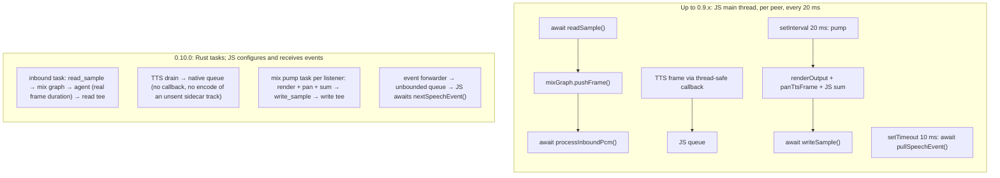
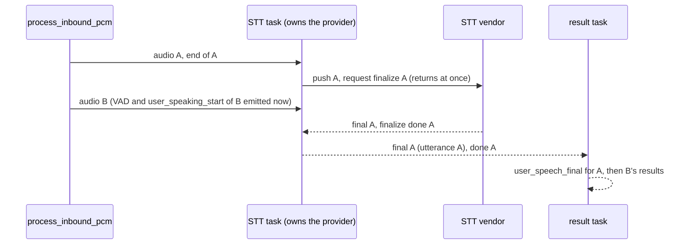

# Performance

This page covers the library's offline speech engines (Sherpa-ONNX streaming speech-to-text and Piper/Melo text-to-speech) and the media path around them. The speech engine numbers were measured in a CPU-limited container, so they are per CPU and scale with the CPUs you give a process. The media path benchmarks and the voice loopback ran natively on the host. Every table can be reproduced with the commands in [Reproduce](#reproduce), and the raw reports are in [`perf-data/2026-10-10`](perf-data/2026-10-10/).

**Test machine:** Apple M4 Pro (14 cores, 48 GiB, macOS 15.7.7), measured on 2026-10-10 with library version 0.9.40. The speech engine probes ran in an arm64 Linux container on Docker Desktop 28.5.1, whose VM has 2 CPUs and 3.8 GiB of memory. Each probe got its own container with `--cpus 1` (`--cpus 2` for the thread sweep). The image is built from [`scripts/perf/voice-cost.Dockerfile`](../scripts/perf/voice-cost.Dockerfile) (`rust:1.99-bookworm`). Every speech engine number is the median of 3 runs. The media path benchmarks and the voice loopback ran on the host without a CPU limit.

## Speech-to-text (Sherpa-ONNX streaming)

Streaming recognition runs one decode per audio chunk per stream. Each stream feeds a 10 s clip in real time, in 20 ms chunks. The table lists, for each number of concurrent streams on one CPU, how far decoding falls behind live audio (lag) and how long the final transcript takes after the last chunk (final). A point counts as real time while the p95 of the worst per-chunk lag stays at or below 500 ms. The model is the English streaming Zipformer (`sherpa-onnx-streaming-zipformer-en-kroko-2025-08-06`) with one ONNX thread. The probe stops at the first point that is not real time, so streams above 24 were not run.

| Streams | Lag p95 (ms) | Final p95 (ms) | Real time |
| ------: | -----------: | -------------: | :-------: |
|       1 |           54 |              7 |    yes    |
|       8 |          220 |              8 |    yes    |
|      16 |          378 |             13 |    yes    |
|      24 |          537 |             20 |    no     |

One CPU keeps 16 streams in real time, with a 500 ms lag budget. Final latency stays under 20 ms at every point.

One ONNX thread per CPU works best for streaming STT. With `SHERPA_STT_NUM_THREADS=2` on the same single CPU, the probe stayed in real time up to 8 streams (lag p95 358 ms) and fell behind at 16 (689 ms). Two threads on one CPU compete with each other and halve the capacity. `SHERPA_POOL_MAX_CONCURRENT_DECODE` limits how many decodes run at the same time, so extra streams wait for a slot instead of oversubscribing the CPUs.

## Text-to-speech cost per voice

Synthesis cost is reported as a real-time factor (RTF): wall seconds spent per second of audio produced for one synthesis of a ~400 character text. An RTF of 0.2 means one CPU can synthesize five seconds of speech per second. "CPU s per audio s" is the process CPU time over all syntheses of the run. The table also shows each voice's cost relative to `amy-medium`, and the time to first audio (a 52 character sentence) when 1, 2 and 4 requests arrive at once. All rows ran with `--cpus 1`, one ONNX thread, and `SHERPA_POOL_MAX_CONCURRENT_TTS` raised to the number of simultaneous requests, so the 4-request column really has four syntheses running at once. RSS is the peak of the whole probe process, including the four engines loaded for the 4-request point.

| Voice                            |  RTF | Cost vs amy-medium | First audio, 1 request, p50 / p95 (ms) | First audio p95, 2 requests (ms) | First audio p95, 4 requests (ms) | CPU s per audio s | RSS (MB) |
| -------------------------------- | ---: | -----------------: | -------------------------------------: | -------------------------------: | -------------------------------: | ----------------: | -------: |
| `vits-piper-en_US-lessac-low`    | 0.05 |              0.78x |                              200 / 217 |                              218 |                              504 |             0.068 |      717 |
| `vits-piper-en_US-amy-low`       | 0.05 |              0.84x |                              254 / 264 |                              266 |                              590 |             0.073 |      830 |
| `vits-piper-en_US-lessac-medium` | 0.07 |              0.99x |                              234 / 287 |                              285 |                              616 |             0.086 |      948 |
| `vits-piper-en_US-amy-medium`    | 0.07 |              1.00x |                              300 / 322 |                              347 |                              789 |             0.087 |      956 |
| `vits-piper-en_US-lessac-high`   | 0.57 |              6.55x |                             886 / 1279 |                             2104 |                             4798 |             0.572 |     1090 |
| `vits-melo-tts-zh_en`            | 0.62 |              7.34x |                              340 / 759 |                              783 |                             2298 |             0.640 |     1488 |

The `-low` Piper voices cost about 20% less than the `-medium` ones, and the `-medium` voices of both speakers cost the same. The `-high` voice and Melo (`vits-melo-tts-zh_en`) cost six to seven times more per audio second, so plan CPUs by voice, not by request count. On one CPU a `-low` or `-medium` voice synthesizes about 14 to 20 seconds of audio per second, `lessac-high` and Melo about 1.6 to 1.8 seconds.

## Threads and CPUs for expensive voices

The two most expensive voices, one request at a time, with different CPU limits and thread counts:

| Voice                          | Container CPUs | `SHERPA_TTS_NUM_THREADS` | First audio p50 / p95 (ms) |  RTF | CPU s per audio s |
| ------------------------------ | -------------: | -----------------------: | -------------------------: | ---: | ----------------: |
| `vits-piper-en_US-lessac-high` |              1 |                        1 |                  860 / 933 | 0.57 |             0.570 |
| `vits-piper-en_US-lessac-high` |              2 |                        1 |                  881 / 957 | 0.58 |             0.574 |
| `vits-piper-en_US-lessac-high` |              2 |                        2 |                  456 / 501 | 0.30 |             0.589 |
| `vits-melo-tts-zh_en`          |              1 |                        1 |                  341 / 346 | 0.62 |             0.619 |
| `vits-melo-tts-zh_en`          |              2 |                        1 |                  339 / 342 | 0.62 |             0.618 |
| `vits-melo-tts-zh_en`          |              2 |                        2 |                  186 / 188 | 0.33 |             0.648 |

`SHERPA_TTS_NUM_THREADS` sets the ONNX intra-op threads of one synthesis. Giving the process more CPUs without raising the thread count does not speed up a single synthesis, because one synthesis only uses the threads it was configured with (rows 1 and 2 and rows 4 and 5 match). Setting threads equal to CPUs cut the time to first audio by about half, and the CPU spent per audio second stayed within 5% (0.570 to 0.589 and 0.619 to 0.648). The Docker VM has 2 CPUs, so the two-CPU rows used all of its cores.

## Engines and memory

`SHERPA_POOL_MAX_CONCURRENT_TTS` sets how many syntheses run in parallel. On one CPU a second engine does not lower latency, since the two syntheses share the same CPU. Each engine also loads its own copy of the model, so memory grows with the engine count.

`vits-piper-en_US-lessac-medium`, `--cpus 1`, one thread, 4 requests arriving at once:

| `SHERPA_POOL_MAX_CONCURRENT_TTS` | Peak RSS (MB) | First audio p95, 4 requests (ms) |
| -------------------------------: | ------------: | -------------------------------: |
|                                1 |           184 |                              448 |
|                                2 |           330 |                              500 |
|                                4 |           575 |                              704 |

Each extra engine added roughly 130 to 150 MB for this voice, and first audio got slower, not faster: with one CPU the extra syntheses compete for the same CPU, and every request finishes later. One engine per CPU is the right size for `-low` and `-medium` voices.

## Phrase cache

When the same text is spoken again with the same voice settings, the audio comes from an in-memory cache and no synthesis runs. `VOICE_TTS_PHRASE_CACHE` controls it (on by default; `0`, `false`, `no` or `off` disables it), and `VOICE_TTS_PHRASE_CACHE_MAX_BYTES` and `VOICE_TTS_PHRASE_CACHE_MAX_ENTRY_BYTES` bound its size. The OpenTelemetry counters `sherpa_tts_phrase_cache_hits` and `sherpa_tts_phrase_cache_misses` show how often it helps.

A synthesis that was cancelled part way (for example by a barge-in) is never cached, so a later request for the same text gets the full phrase. This is covered by [`tts_cancel_not_cached_test.rs`](../crates/vendor-sherpa-onnx/tests/tts_cancel_not_cached_test.rs).

## Media path

These are micro benchmarks of the code that runs for every audio frame. They run through [`scripts/perf/run-perf-baseline.sh`](../scripts/perf/run-perf-baseline.sh). They ran natively on the Apple M4 Pro, not in a container. The numbers are relative: they are meant for comparing two commits on the same machine, and a server core will be slower than this laptop-class core. Criterion benches report the median of their own samples, the probes the median of 7 runs.

| Bench           | Measurement                                             |            Median |
| --------------- | ------------------------------------------------------- | ----------------: |
| `inbound_frame` | One `process_inbound_pcm` call, silent frame            |           4.03 µs |
| `inbound_frame` | One `process_inbound_pcm` call, voiced frame            |           4.04 µs |
| `inbound_frame` | Allocations per voiced frame                            |              7.06 |
| `resample`      | 10 s of 22,050 Hz mono to 48 kHz stereo, one-shot       |           1.05 ms |
| `resample`      | Same audio, streaming in 0.5 s pushes                   |           0.89 ms |
| `resample`      | Peak heap, one-shot / streaming                         | 4.28 MB / 0.14 MB |
| `opus_encode`   | One 20 ms stereo frame                                  |          111.6 µs |
| `tts_drain`     | Drain one 20 ms frame of a 10 s TTS chunk into a writer |           21.7 µs |
| `tts_drain`     | Bytes allocated per frame                               |             6,157 |
| `idle_agents`   | CPU time per second per agent, 100 idle agents          |          129.5 µs |

A 20 ms frame arrives 50 times per second, so Opus encoding of one session's outbound audio takes 111.6 µs per 20 ms, or **0.56% of one core per session**. Draining TTS audio adds about 0.11% (21.7 µs per 20 ms frame), and an idle agent costs about 0.013% of a core. The `idle_agents` probe varied by 9.7% across its 7 runs, the others by 1% or less.

| Bench           | Kind      | What it measures                                                                                                                                                     |
| --------------- | --------- | -------------------------------------------------------------------------------------------------------------------------------------------------------------------- |
| `inbound_frame` | criterion | Cost of one `VoiceAgent::process_inbound_pcm` call with a mock STT, energy VAD and an open gate, for a silent and a voiced frame, plus allocations per voiced frame. |
| `resample`      | criterion | Resampling 10 s of 22,050 Hz mono audio to 48 kHz stereo s16le, one-shot and streaming (0.5 s pushes), plus peak heap use.                                           |
| `opus_encode`   | criterion | `PcmEncoder::encode` on one 20 ms stereo frame with the default Opus settings.                                                                                       |
| `tts_drain`     | probe     | CPU cost per 20 ms frame of draining a 10 s TTS chunk into a writer, and bytes allocated per frame as a proxy for copies.                                            |
| `idle_agents`   | probe     | CPU time per second per agent for 100 started `VoiceAgent`s that are idle for 5 s.                                                                                   |

## Voice loopback under load

The `start:roundtrip-load` example runs several speaker/listener legs at the same time in one process. Each leg is a WebRTC loopback with a Sherpa TTS speaker and a Sherpa STT listener, and each leg plays several turns in sequence. A run fails if any turn does not produce a `user_speech_final` containing the leg's keyword, or if anything throws or times out.

It has two modes. The normal mode runs `SHERPA_LOAD_LEGS` legs (default 8) for `SHERPA_LOAD_TURNS` turns (default 5). Capacity mode (`SHERPA_LOAD_CAPACITY=1`) steps through 2, 4, 6, 8, 10, 12, 16, 20, 24, 32, 40 and 48 legs until a step fails. A step passes while it has no failures and its final-latency p95 stays within `SHERPA_LOAD_SLO_DELTA_MS` (default 1000) of the 2-leg step.

The report has final-latency percentiles, CPU per session-minute, event-loop lag and RSS. These are reported, not gated. The npm scripts turn the phrase cache off (`VOICE_TTS_PHRASE_CACHE=0`) so every turn runs a real synthesis; `start:roundtrip-load-cached` keeps it on.

Both modes ran natively on the Apple M4 Pro (14 cores) in one process, with the English Kroko streaming STT model and the `vits-piper-en_US-amy-low` voice, the phrase cache off and no CPU limit. Capacity here means legs in one process on this host, not sessions per CPU. Use the container tables above to size CPUs.

Normal mode, 8 legs x 5 turns (40 turns, all succeeded, 24 s of wall time):

| Metric                      |          Value |
| --------------------------- | -------------: |
| TTS start latency p50 / p95 |    71 / 504 ms |
| Final latency p50 / p95     | 2066 / 2195 ms |
| CPU per session-minute      |      4.5 CPU s |
| Event loop lag p99          |         1.9 ms |
| RSS at the end              |         757 MB |

Capacity mode, `SHERPA_LOAD_TURNS=2`. The 2-leg step sets the baseline (final p95 2069 ms), so a step passes while final p95 is at most 3069 ms:

| Legs | TTS start p50 / p95 (ms) | Final p50 / p95 (ms) | CPU s per session-minute | RSS at the end (MB) | Within baseline + 1 s |
| ---: | -----------------------: | -------------------: | -----------------------: | ------------------: | :-------------------: |
|    2 |                 67 / 478 |          1895 / 2069 |                     7.92 |                 559 |       baseline        |
|    4 |                  64 / 79 |          2027 / 2119 |                     4.46 |                 628 |          yes          |
|    6 |                  65 / 84 |          2060 / 2164 |                     4.17 |                 685 |          yes          |
|    8 |                  57 / 76 |          2042 / 2191 |                     3.78 |                 721 |          yes          |
|   10 |                  61 / 77 |          2036 / 2186 |                     3.80 |                 744 |          yes          |
|   12 |                  60 / 86 |          2058 / 2183 |                     3.71 |                 773 |          yes          |
|   16 |                 67 / 105 |          2102 / 2299 |                     3.85 |                 840 |          yes          |
|   20 |                 90 / 147 |          2080 / 2178 |                     3.67 |                 896 |          yes          |
|   24 |                 91 / 274 |          2094 / 2242 |                     3.52 |                 988 |          yes          |
|   32 |                125 / 451 |          2140 / 2302 |                     3.35 |                1140 |          yes          |
|   40 |                 91 / 674 |          2286 / 2938 |                     3.20 |                1236 |          yes          |
|   48 |                176 / 885 |          3146 / 4243 |                     2.74 |                1334 |          no           |

All 12 steps completed every turn; step 48 only missed the latency budget. The run reported `max_legs_at_slo=40`. Final latency sits near 2 s at every step because of the VAD and gate-hold floor, so the budget is a delta over the 2-leg step.

## Reliability under load

These tests cover the failure modes that show up when many sessions start, stop and share engines.

- Concurrent STT decodes give the same transcript as serial decodes: [`stt_concurrent_equals_serial_test.rs`](../crates/vendor-sherpa-onnx/tests/stt_concurrent_equals_serial_test.rs)
- Starting and stopping sessions repeatedly releases the agent's workers and audio writer, including when a session is dropped without `stop()` and when it is dropped mid-playback: [`session_churn_test.rs`](../crates/speech/tests/session_churn_test.rs)
- Pool churn: after many STT and TTS sessions the pool's active-session count returns to zero: [`session_churn_pool_test.rs`](../crates/vendor-sherpa-onnx/tests/session_churn_pool_test.rs)
- A cluster speech client dropped without `stop()` closes its streams: `cluster_stt_drop_without_stop_closes_streams` in [`cluster_vendor_test.rs`](../crates/vendor-cluster-speech/tests/cluster_vendor_test.rs)
- Large messages (1 MiB and 4 MB single TTS messages arrive intact, and messages over the default gRPC limit are accepted): `tts_receives_1mib_single_message_intact`, `tts_receives_4mb_single_message_intact` and `tts_accepts_message_over_default_limit` in [`cluster_vendor_test.rs`](../crates/vendor-cluster-speech/tests/cluster_vendor_test.rs)
- A cancelled TTS synthesis is never cached: [`tts_cancel_not_cached_test.rs`](../crates/vendor-sherpa-onnx/tests/tts_cancel_not_cached_test.rs)
- Lexicon models (Melo) synthesize, and Piper models still do: [`tts_lexicon_model_test.rs`](../crates/vendor-sherpa-onnx/tests/tts_lexicon_model_test.rs)
- Model folders that contain only git-lfs pointer files are rejected with a clear error instead of aborting ONNX Runtime, and Melo folders resolve their lexicon, dictionary and rule FSTs: unit tests in [`tts_model_paths.rs`](../crates/vendor-sherpa-onnx/src/tts_model_paths.rs)

## Voice media loops in Rust (0.10.0)

Up to 0.9.x, the per-frame work of a voice session ran on the Node.js main thread. For every peer and every 20 ms frame, JS read the inbound frame (`readSample`), pushed it into the mix graph, handed it to the agent (`processInboundPcm`), received each agent TTS frame through a thread-safe callback, and ran the client-mix pump (`renderOutput`, `panTtsFrame`, a JS loop that summed 1,920 samples, `writeSample`). On top of that, each agent polled for speech events every 10 ms. Since 0.10.0 these loops run in Rust tasks, and JS only configures them and receives events.



- **Mix pump.** `ClientAudioMixer` starts one Rust task per listener with the same scheduling as the JS pump: one frame per 20 ms slot, at most 4 frames per wake-up, a clock rebase when it falls behind, no bursts to the network. The TTS queue is unbounded. A backlog plays late but complete, and a throttled `[mix] tts backlog` line reports it. JS keeps start/stop/pause/resume/burst/discard and a once-a-second stats poll.
- **Inbound loop.** `VoiceAgent.start()` runs the inbound loop in Rust when the inbound track is a native `RemoteAudioTrack` whose `readSample` was not wrapped in JS. The loop pushes frames into the mix graph when the session is mixed. `RemoteAudioTrack.setReadSampleTee()` gives recorders the inbound PCM without wrapping `readSample`.
- **Speech events.** A Rust forwarder moves every event into an unbounded per-agent queue as it is emitted, and the SDK awaits `nextSpeechEvent()`. Before, a slow JS consumer could miss events when the 256-slot event channel lagged.
- **Fallback switches.** `NWR_MIX_NATIVE_PUMP=0` and `NWR_NATIVE_INBOUND=0` select the JS loops. The JS loops are also used automatically for mock mix graphs, non-native tracks and JS-wrapped `readSample`.

### Results

Workload: the `start:roundtrip-counting-echo-lid-multi` example (10 concurrent voice sessions). The numbers are for its echo-server process, which runs `VoiceAgentSessionHost` with the client mix, Sherpa STT and TTS and language ID for all 10 sessions. Native on the Apple M4 Pro, unthrottled, 3 runs per mode, measured with [`scripts/perf/js-thread-probe.mjs`](../scripts/perf/js-thread-probe.mjs) (cumulative over each 18 s run). The modes were selected with the switches above in one build.

| Mode                           | JS main-thread CPU (ms per s) | Event-loop utilization | Process CPU, all threads (ms per s) | Event-loop delay p99 (ms) |
| ------------------------------ | ----------------------------: | ---------------------: | ----------------------------------: | ------------------------: |
| JS loops (0.9.x behavior)      |                       106–109 |            0.112–0.114 |                             856–932 |                 12.2–12.4 |
| Native mix pump                |                         38–40 |            0.043–0.045 |                             855–909 |                 12.4–12.6 |
| Native mix pump + inbound loop |                         26–27 |            0.026–0.029 |                             834–845 |                 12.4–12.6 |
| All native (0.10.0 default)    |                        **20** |            0.020–0.021 |                             801–846 |                 12.5–12.6 |

The JS main thread now spends about 2 % of one core on 10 voice sessions, down from about 11 % (−81 %). Total process CPU dropped 6–9 %, mostly because TTS frames are no longer Opus-encoded into an unsent sidecar track. The event-loop delay is dominated by the 10 ms timer resolution and did not change.

Per-run data: [`perf-data/2026-10-14/runs.md`](perf-data/2026-10-14/runs.md) and the raw probe lines in [`perf-data/2026-10-14/probe-lines.txt`](perf-data/2026-10-14/probe-lines.txt).

## Behavior under CPU starvation

A voice host that gets too little CPU used to lose words. Measured with a SIGSTOP duty cycle on the whole 10-session example (5 ms run / 45 ms stop ≈ 10 % CPU; 5 ms / 20 ms ≈ 20 %), and with a busy-wait that blocks the echo server's JS thread for 4 s every 12 s:

| Scenario (10 sessions per run)            | 0.9.48                                        | 0.10.0                                |
| ----------------------------------------- | --------------------------------------------- | ------------------------------------- |
| 4 s JS stall every 12 s + 5/20 duty cycle | 0 of 3 runs clean, 11 sessions lost 1–6 words | 3 of 3 runs clean                     |
| 5/45 duty cycle                           | up to 8 of 10 sessions lost middle words      | 0 sessions with lost words in 9 runs  |
| 5/20 duty cycle                           | 20 of 20 runs clean                           | 198 of 200 sessions clean (see below) |

The causes fixed between those versions:

1. **The client-mix pump dropped agent speech.** Its TTS queue held 1 s and dropped the oldest frames when JS fell behind, so the middle of a reply was lost. The queue is now unbounded, and a barge-in or `flushTts()` discards it.
2. **The STT "no partial" safety net closed a live stream.** No PCM for `sttListenTimeoutMs` (4 s) looked like a stopped sender, while the audio was only waiting behind a frozen reader. While VAD is in speech, only the hard timeout (3 × `sttListenTimeoutMs`, 12 s) closes the stream now. A sender that stops completely mid-speech is therefore closed after 12 s instead of 4 s. Frames that keep flowing close at the normal end of speech, as before.
3. **A short first word fell out of the pre-roll.** A quiet word below `minSpeechDurationMs`, followed by a pause longer than the pre-roll, never reached STT. Such bursts are now kept for up to 3 s and prepended to the next utterance, without duplicating audio that is still in the pre-roll.

The two remaining 5/20 sessions were a doubled "eight" on one TTS rendering of "eight, nine" (the received audio has no repeated part, and a replay of it transcribes correctly) and one lost first word after a 1.54 s TTS pause, which the 3 s window above now covers.

## STT off the inbound path (0.11.0)

Up to 0.10.x, `VoiceAgent::process_inbound_pcm` called the STT vendor itself. At the end of an utterance it awaited `finalize_utterance()` while holding the agent's STT lock, and every later frame needed that lock to push audio. A slow final therefore stopped the agent from processing audio: no VAD, no `user_speaking_start` and no barge-in until the vendor answered. The audio itself was not lost (the inbound pump queues it), only late.

Since 0.11.0 each agent has one STT task that owns the provider. `process_inbound_pcm` runs VAD and sends audio and end-of-utterance markers to that task in order, and a second task applies the results (partials, finals, not found) to the utterance they belong to. Providers that can end an utterance without waiting (`FinalizeMode::Deferred`, the cluster client) return from `request_finalize` at once and deliver the final later. The others keep their blocking `finalize_utterance`, which now blocks only the STT task.



| Test (VoiceAgent + cluster client + mock speech server over gRPC)    | 0.10.1 longest inbound call | 0.11.0 longest inbound call |
| -------------------------------------------------------------------- | --------------------------: | --------------------------: |
| 3.3 s late final                                                     |                       3.3 s |                     1–10 ms |
| 3.3 s late final + 3 s late `Finalized`                              |                       6.3 s |                     1–10 ms |
| 10 s late final, next utterance spoken 1 s after the first one ended |   about 8 s (finalize wait) |                      ≤ 5 ms |
| Stream opens refused for 60 s while three utterances are spoken      |      about 60 s (open wait) |                     ≤ 15 ms |

What callers see:

- The next utterance's events can come before the previous utterance's final when that final is slow; finals stay in utterance order, and every utterance event carries its `utteranceId`. Pair `user_speaking_start` / `user_speaking_end` by `utteranceId`.
- A final that arrives after its utterance already ended (the finalize wait expired and the last partial was used) is not emitted for the next utterance. It is logged and counted in `voice_stt_late_result`.
- The cluster client's finalize wait (`SPEECH_STT_FINALIZE_WAIT_MS`, 8 s plus queued audio) starts when its stream is open. While opens are refused, the wait is bounded by `sttOpenWaitMaxMs` (120 s).
- Audio waiting for the STT task counts as decode backlog for the "no partial" safety net, and `voice_stt_actor_backlog_ms` reports it. Nothing is dropped.

Tests: [`slow_final_next_utterance_fullstack_test.rs`](../crates/vendor-cluster-speech/tests/slow_final_next_utterance_fullstack_test.rs), [`refused_open_streak_fullstack_test.rs`](../crates/vendor-cluster-speech/tests/refused_open_streak_fullstack_test.rs), [`stt_actor_agent_order_test.rs`](../crates/speech/tests/stt_actor_agent_order_test.rs) and the Sherpa smoke `start:roundtrip-slow-final`.

## Tuning

| Variable                            | Default               | What it changes                                                                                                                                     | Recommendation                                                                                                                                                                                                             |
| ----------------------------------- | --------------------- | --------------------------------------------------------------------------------------------------------------------------------------------------- | -------------------------------------------------------------------------------------------------------------------------------------------------------------------------------------------------------------------------- |
| `SHERPA_STT_NUM_THREADS`            | `1`                   | ONNX intra-op threads of the streaming recognizer.                                                                                                  | 1 thread per CPU.                                                                                                                                                                                                          |
| `SHERPA_POOL_MAX_CONCURRENT_DECODE` | CPU count (minimum 1) | How many STT decodes run at once.                                                                                                                   | Leave at the CPU count.                                                                                                                                                                                                    |
| `SHERPA_TTS_NUM_THREADS`            | `2`                   | ONNX intra-op threads of one synthesis.                                                                                                             | Many concurrent sessions per CPU: 1 for `-low` / `-medium` voices (threads compete for the CPU). One session at a time: 2 lowers first audio (amy-low 254 → 112 ms p50 on 1 CPU). `-high` voices and Melo: threads = CPUs. |
| `SHERPA_POOL_MAX_CONCURRENT_TTS`    | `2`                   | How many syntheses run at once, and how many engines (model copies) are loaded.                                                                     | `-low` / `-medium` voices: 1 engine per CPU. `-high` voices and Melo: 1.                                                                                                                                                   |
| `NWR_MIX_NATIVE_PUMP`               | on                    | `0` runs the client-mix pump in JS instead of the Rust task.                                                                                        | Keep on. Use `0` only to compare.                                                                                                                                                                                          |
| `NWR_NATIVE_INBOUND`                | on                    | `0` reads inbound audio in a JS loop instead of the Rust task.                                                                                      | Keep on. Recorders should use `setReadSampleTee()` instead of wrapping `readSample`, so the Rust loop stays active.                                                                                                        |
| `VOICE_TTS_PHRASE_CACHE`            | on                    | Serves repeated phrases from memory. Size limits: `VOICE_TTS_PHRASE_CACHE_MAX_BYTES` (16 MiB) and `VOICE_TTS_PHRASE_CACHE_MAX_ENTRY_BYTES` (2 MiB). | Keep on for agents that repeat greetings and prompts.                                                                                                                                                                      |

## Reproduce

Run these from the repository root. The speech probes need the models downloaded first.

Download the models once. The STT model is the example's default English streaming Zipformer, and the TTS voices are the ones the voice-cost probe compares (`npm run download-tts:list --workspace=@node-webrtc-rust/example-voice-agent-local-sherpa` shows every voice):

```bash
npm run download-stt --workspace=@node-webrtc-rust/example-voice-agent-local-sherpa
npm run download-tts:en --workspace=@node-webrtc-rust/example-voice-agent-local-sherpa
npm run download-tts --workspace=@node-webrtc-rust/example-voice-agent-local-sherpa -- --lang=en-amy-medium
npm run download-tts --workspace=@node-webrtc-rust/example-voice-agent-local-sherpa -- --lang=en-lessac-low
npm run download-tts:en-lessac --workspace=@node-webrtc-rust/example-voice-agent-local-sherpa
npm run download-tts:en-lessac-high --workspace=@node-webrtc-rust/example-voice-agent-local-sherpa
npm run download-tts:zh --workspace=@node-webrtc-rust/example-voice-agent-local-sherpa
```

Media path micro benchmarks (criterion benches and the `tts_drain` and `idle_agents` probes). They run natively and are relative, so compare two runs on the same machine:

```bash
bash scripts/perf/run-perf-baseline.sh <label>
```

Speech engine probes in a container limited to one CPU, three runs each. This produces the STT capacity table and the TTS cost table:

```bash
PROBE_MODELS_DIR=examples/voice-agent-local-sherpa/.models PROBE_TTS_SESSIONS=1,2,4 PROBE_STT_STREAMS=1,8,16,24,32,40,48,56,64 bash scripts/perf/run-voice-cost.sh --cpus 1 --runs 3
```

The script drives the `tts_voice_cost_probe` and `stt_stream_capacity_probe` tests in `crates/vendor-sherpa-onnx/tests/voice_cost_probe.rs` and summarizes them with `scripts/perf/voice-cost-report.mjs`. The first run builds the image from `scripts/perf/voice-cost.Dockerfile`. Docker Desktop shares its VM's cores, so give the VM at least one more CPU than `--cpus`.

Thread sweep for the two expensive voices (run it with `--cpus 2 --threads 2`, `--cpus 2 --threads 1` and `--cpus 1 --threads 1`):

```bash
VOICE_COST_VOICES="vits-piper-en_US-lessac-high vits-melo-tts-zh_en" PROBE_MODELS_DIR=examples/voice-agent-local-sherpa/.models PROBE_TTS_SESSIONS=1 bash scripts/perf/run-voice-cost.sh --cpus 2 --threads 2 --runs 3
```

Engine count and memory (run it with `SHERPA_POOL_MAX_CONCURRENT_TTS` set to 1, 2 and 4):

```bash
SHERPA_POOL_MAX_CONCURRENT_TTS=2 VOICE_COST_VOICES=vits-piper-en_US-lessac-medium PROBE_MODELS_DIR=examples/voice-agent-local-sherpa/.models PROBE_TTS_SESSIONS=4 bash scripts/perf/run-voice-cost.sh --cpus 1 --runs 3
```

STT with two threads on one CPU (the other voice is only there because the script always runs one TTS probe):

```bash
VOICE_COST_VOICES=vits-piper-en_US-amy-low PROBE_MODELS_DIR=examples/voice-agent-local-sherpa/.models PROBE_TTS_SESSIONS=1 PROBE_STT_STREAMS=1,8,16,24,32 bash scripts/perf/run-voice-cost.sh --cpus 1 --threads 2 --runs 3
```

Voice loopback under load, in normal mode and in capacity mode. These run natively and need the release build of the native addon (`npm run build --workspace=@node-webrtc-rust/bindings`) and the TypeScript build (`bash scripts/ci/build-ts-workspace.sh`):

```bash
npm run start:roundtrip-load --workspace=@node-webrtc-rust/example-voice-agent-local-sherpa
SHERPA_LOAD_CAPACITY=1 SHERPA_LOAD_TURNS=2 npm run start:roundtrip-load --workspace=@node-webrtc-rust/example-voice-agent-local-sherpa
```

### JS main-thread cost (0.10.0 media loops)

The probe is a preload, so it measures any Node.js process without code changes. For the 10-session example, match the echo-server child:

```bash
PERF_PROBE=1 PERF_PROBE_MATCH=roundtrip-counting-echo-lid-multi-echo-server.ts \
  NODE_OPTIONS="--import $PWD/scripts/perf/js-thread-probe.mjs" \
  SHERPA_MULTI_PCM_CAPTURE=0 WEBRTC_INCLUDE_LOOPBACK_CANDIDATES=1 \
  npm run start:roundtrip-counting-echo-lid-multi --workspace=@node-webrtc-rust/example-voice-agent-local-sherpa
# compare with the JS loops: prefix NWR_MIX_NATIVE_PUMP=0 NWR_NATIVE_INBOUND=0
```

Read the last `cum_js_thread_cpu_ms_per_s` value. Turn the example's PCM capture off (`SHERPA_MULTI_PCM_CAPTURE=0`): its capture tee adds a JS callback per frame and peer. Do not attach a CPU profiler while measuring, because the inspector profiler inflates event-loop utilization several times. On macOS, set `WEBRTC_INCLUDE_LOOPBACK_CANDIDATES=1` if the application firewall drops UDP on the LAN interface.

## Raw data

The generated reports behind these tables are in [`perf-data/2026-10-10`](perf-data/2026-10-10/):

| Files                                                                  | Content                                                                     |
| ---------------------------------------------------------------------- | --------------------------------------------------------------------------- |
| `voice-cost-20261010-215730.{md,json}`                                 | STT capacity and TTS cost per voice, 1 CPU                                  |
| `voice-cost-20261010-224347.{md,json}`                                 | STT capacity with two threads, 1 CPU                                        |
| `voice-cost-20261010-221654`, `-222027`, `-222624` (`.md` and `.json`) | Thread sweep: 2 CPUs and 2 threads, 2 CPUs and 1 thread, 1 CPU and 1 thread |
| `voice-cost-20261010-223247`, `-223345`, `-223445` (`.md` and `.json`) | Engine sweep: `SHERPA_POOL_MAX_CONCURRENT_TTS` 1, 2 and 4                   |
| `media-path-2b24d82.json`                                              | Media path benches and probes, every probe run                              |
| `roundtrip-load-8x5.jsonl`, `roundtrip-load-capacity.jsonl`            | The `perf_probe` lines of the two voice loopback runs                       |

The data behind [Voice media loops in Rust](#voice-media-loops-in-rust-0100) and [Behavior under CPU starvation](#behavior-under-cpu-starvation) is in [`perf-data/2026-10-14`](perf-data/2026-10-14/):

| Files             | Content                                                                                                             |
| ----------------- | ------------------------------------------------------------------------------------------------------------------- |
| `runs.md`         | One row per run: verdict, duration, sessions with word errors, failure class, which loops were native, probe values |
| `probe-lines.txt` | The raw 5 s probe lines of every unthrottled measurement run, per mode                                              |
