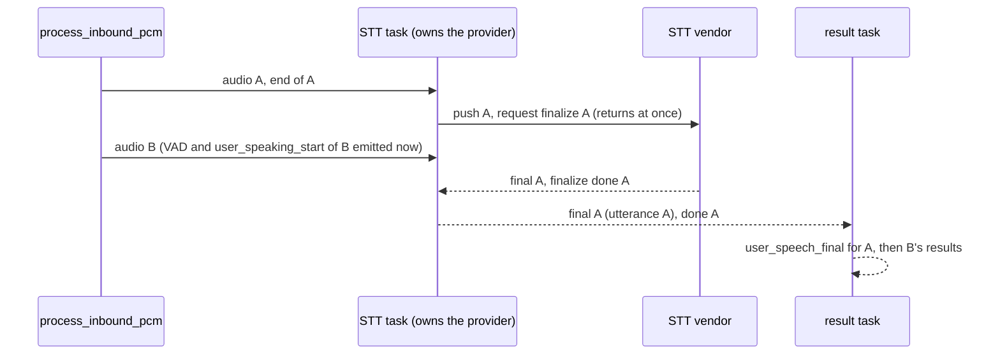

# 0.11.0: speech-to-text no longer blocks the voice agent

This page compares 0.10.1 and 0.11.0: what changed in the voice agent, what the release fixes, and how each claim is measured. The short list of changes is in the [CHANGELOG](../../CHANGELOG.md#0110---2026-10-15); raw perf data is in [`../perf-data/2026-10-15/`](../perf-data/2026-10-15/runs.md).

## What changed

### Up to 0.10.1

`VoiceAgent::process_inbound_pcm` handled one 20 ms audio frame at a time and called the STT vendor itself. When an utterance ended, it waited for the vendor's final while holding the agent's STT lock, and every later frame needed that lock to push its audio. While the vendor took its time, the agent processed no frame at all:

- no VAD, so no `vad_triggered` and no `user_speaking_start` for the next utterance;
- no barge-in, so the agent kept talking over the caller;
- with the cluster speech client, a refused stream open (a speech pod at its stream cap) could hold the agent for up to 120 s.

The audio itself was not lost (since 0.10.1 the inbound pump queues it), but everything the agent derives from it arrived late by the vendor's delay.

### 0.11.0

Each agent has one STT task that owns the STT provider. `process_inbound_pcm` runs VAD and hands audio and end-of-utterance markers to that task in order. It never waits for the vendor. A second task applies the results (partials, finals, not found) to the utterance they belong to.



What follows from that:

- **`SttProvider`** gains `finalize_mode()`, `request_finalize()`, `poll_output()` (with `SttOutput::FinalizeDone`) and `finalize_wait_ms()`. The defaults keep existing providers working unchanged; their blocking `finalize_utterance()` now blocks only the STT task.
- **Cluster speech client:** `request_finalize()` returns at once and the final arrives later. In per-utterance mode, audio that follows a finalize before its answer moves to the next stream with its own finalize, so every turn keeps its own stream and no audio is lost. After a run of refused stream opens, the finalize wait (`SPEECH_STT_FINALIZE_WAIT_MS`, 8 s plus queued audio) starts when the open succeeds.
- **Every utterance event carries its `utteranceId`**, now also `user_stt_start`, `stt_stream_start`, `stt_stream_end` and `user_stt_end`.
- **Event order:** the next utterance's events can arrive before the previous utterance's `user_speaking_end` and final when that final is slow. Finals and `user_stt_not_found` still arrive in utterance order, and the order within one utterance is unchanged. Hosts that pair `user_speaking_start` with `user_speaking_end` (for example to meter speech time) should pair them by `utteranceId`.
- **Late results:** a final that arrives after its utterance already ended is attributed to that utterance, logged and counted (`voice_stt_late_result`). It is never emitted as the next utterance's final.
- **Rust callers:** STT results are emitted by the result task, so `process_inbound_pcm` returning no longer means the results of that frame were emitted. `VoiceAgent::wait_stt_idle(timeout)` waits until they were. JS hosts consume events asynchronously and need no change.
- **Idle agents** do not poll their provider. The STT task polls every 20 ms from the first audio or finalize request until 10 s after the last one.

## Fixes in this release

Two of these were in 0.10.1; the other four were found while testing the new STT task, before release.

| Area                  | Problem                                                                                                                                                                                                                                                       | Fixed in 0.11.0                                    |
| --------------------- | ------------------------------------------------------------------------------------------------------------------------------------------------------------------------------------------------------------------------------------------------------------- | -------------------------------------------------- |
| signaling (in 0.10.1) | `SignalingClient.disconnect()`, or a `connect()` that replaces a socket, threw an uncaught "WebSocket was closed before the connection was established" when the WebSocket handshake was still pending, e.g. a session torn down during a signaling reconnect | The discarded socket keeps an error listener       |
| speech (in 0.10.1)    | A slow STT final, or a refused stream open, stopped VAD, speech events and barge-in for the whole wait                                                                                                                                                        | STT runs in its own task, see above                |
| speech (pre-release)  | With `bargeIn.requireSttPartial`, a late final of an earlier utterance could interrupt a reply that started after that utterance ended                                                                                                                        | Only the utterance being spoken now can barge in   |
| speech (pre-release)  | After a long run of refused stream opens, the finalize deadline had already expired when the open succeeded, so every waiting utterance ended in `user_stt_not_found`                                                                                         | The finalize wait restarts when the open completes |
| speech (pre-release)  | Releasing an STT hold (language switch) could wipe the new model's partial under CPU load, so the utterance ended in `user_stt_not_found` instead of its last-partial final                                                                                   | The partial is kept                                |
| speech (pre-release)  | Idle agents polled the provider every 20 ms, about twice the idle CPU of 0.10.1                                                                                                                                                                               | No polling while idle                              |

## Measured: 0.10.1 vs 0.11.0

### The agent keeps hearing while STT is slow

These run the real `VoiceAgent`, the cluster speech client and a mock speech server over gRPC. The inbound loop calls `process_inbound_pcm` every 20 ms, like the native inbound pump.

| Scenario                                                         | 0.10.1: longest `process_inbound_pcm` call |  0.11.0 | Test                                          |
| ---------------------------------------------------------------- | -----------------------------------------: | ------: | --------------------------------------------- |
| 3.3 s late final                                                 |                                      3.3 s | 1–10 ms | `slow_final_agent_deaf_fullstack_test.rs`     |
| 3.3 s late final + 3 s late `Finalized`                          |                                      6.3 s | 1–10 ms | same file                                     |
| 10 s late final, next utterance spoken 1 s after the first ended |                  about 8 s (finalize wait) |  ≤ 5 ms | `slow_final_next_utterance_fullstack_test.rs` |
| Stream opens refused for 60 s while three utterances are spoken  |                                 about 60 s | ≤ 15 ms | `refused_open_streak_fullstack_test.rs`       |

In the 10 s case, the next utterance's `user_speaking_start` comes within 200 ms of its first loud frame, and both finals arrive with the right `utteranceId`, in order. In the 60 s case every audio byte the agent pushed reaches the server (byte counts compared), and every utterance ends with exactly one final. All of these live in `crates/vendor-cluster-speech/tests/`.

Over real WebRTC, the Sherpa smoke `npm run start:roundtrip-slow-final --workspace=@node-webrtc-rust/example-voice-agent-local-sherpa` holds every STT final back by 6 s (test hook `SPEECH_STT_TEST_FINAL_DELAY_MS`) and checks that:

- the next turn's `user_speaking_start` comes within 1 s of its first voiced frame (0.10.1: about 6 s);
- VAD barge-in fires within 1 s of the interrupting phrase and the agent's audio stops;
- semantic barge-in fires on the interrupting phrase's first partial, after the earlier final;
- the later event really came before the earlier final, so the overlap was tested.

### Ordering and safety

`crates/speech/tests/stt_actor_agent_order_test.rs` drives a scripted provider with explicit gates (no sleeps):

- a late final lands on its own utterance;
- a final that arrives after its utterance timed out is ignored, not given to the next one;
- the next utterance's start comes before the earlier final while terminals stay in order;
- the "no partial" timeout of the next utterance waits while the earlier one is still being answered;
- STT hold and config swap interplay;
- barge-in while a final is pending.

`provider_that_never_settles_cannot_block_inbound` uses a provider whose calls never return; every `process_inbound_pcm` call still returns. `stt_calls_only_in_actor_test.rs` fails the build when anything outside the STT task calls an `SttProvider`.

### Performance

Same machine (Apple M4 Pro), release builds, base and head alternating per measurement. Details: [`../perf-data/2026-10-15/runs.md`](../perf-data/2026-10-15/runs.md).

| Measurement                                                                   |               0.10.1 |               0.11.0 |
| ----------------------------------------------------------------------------- | -------------------: | -------------------: |
| Media micro benchmarks (inbound frame, resample, Opus encode, TTS drain)      |                      |          within ±3 % |
| 10 voice sessions: JS main-thread CPU                                         |              18 ms/s |           18–19 ms/s |
| 10 voice sessions: process CPU, all threads                                   |         563–571 ms/s |         567–583 ms/s |
| Voice loopback load: final latency p50 / p95                                  |       2090 / 2178 ms |       2056 / 2171 ms |
| Voice loopback load: CPU per session-minute                                   |               4.36 s |               4.41 s |
| Voice loopback capacity (legs within the latency target)                      |               40, 48 |               48, 40 |
| Capacity: CPU per session-minute at 48 legs                                   |          2.77–2.78 s |               2.86 s |
| Idle agent CPU (`idle_agents` probe, µs per agent-second, 5 alternating runs) | 137–154 (median 148) | 133–172 (median 159) |

The extra CPU at 48 legs (about 3 %) is the STT task and the result task each agent now has. An idle agent costs about the same as on 0.10.1; the first 0.11.0 build, which still polled every 20 ms while idle, measured 214–239.

### In a deployment under load

Two voice-agent load runs (45 and 30 concurrent conversations of about 40 turns each, cluster speech service) on 0.10.1 and on 0.11.1, same scenario and hosts:

| Run                      | Clean conversations | Reply after final p50 / p95 / p99 ms | `inbound processing behind` lines |
| ------------------------ | ------------------: | -----------------------------------: | --------------------------------: |
| 45 conversations, 0.10.1 |               45/45 |                      171 / 479 / 622 |                                 0 |
| 45 conversations, 0.11.1 |               45/45 |                      150 / 462 / 606 |                                 0 |
| 30 conversations, 0.10.1 |               30/30 |                      137 / 414 / 557 |                                 0 |
| 30 conversations, 0.11.1 |               30/30 |                      129 / 388 / 521 |                                 0 |

The 0.10.1 runs had a healthy speech service, so they show no stall either. The 0.11.1 runs hit both cases the STT task is for. At the start of the 45 run the speech service refused stream opens for up to 1.1 s because it was at its stream cap. In the 30 run a slow minute gave 34 turns a final of 6 to 7.6 s. Both passed without a delayed inbound frame, and every final landed on its own utterance.

## 0.11.1

0.11.1 fixes a connect stall in the vendored ICE agent (seen on macOS). When the socket of the nominated candidate pair stopped sending, the controlling agent re-nominated the same pair forever and the DTLS handshake write over it never returned. The peer stayed in ICE `checking`. Now the controlling agent nominates the next pair after 2 s without an answer, the controlled agent follows a new nomination, and data writes (DTLS, SRTP, SCTP) on a UDP pair are bounded at 100 ms like STUN writes. Test: `third_party/webrtc-ice/src/agent/agent_failover_test.rs`.

## How to measure it yourself

```bash
# full stack: the agent keeps hearing during slow finals and refused opens
cargo test -p node-webrtc-rust-vendor-cluster-speech --test slow_final_agent_deaf_fullstack_test --test slow_final_next_utterance_fullstack_test --test refused_open_streak_fullstack_test -- --test-threads=1 --nocapture

# ordering, never-settling provider, scan guard
cargo test -p node-webrtc-rust-speech --test stt_actor_agent_order_test --test stt_actor_test --test stt_actor_agent_wiring_test --test stt_calls_only_in_actor_test

# real WebRTC with a held final (after npm run build:native and bash scripts/ci/build-ts-workspace.sh)
WEBRTC_INCLUDE_LOOPBACK_CANDIDATES=1 npm run start:roundtrip-slow-final --workspace=@node-webrtc-rust/example-voice-agent-local-sherpa

# perf: same commands as in performance.md#reproduce, run once per version
bash scripts/perf/run-perf-baseline.sh <label>
node scripts/perf/compare-perf.mjs .test-logs/perf/<base>.json .test-logs/perf/<head>.json
```

In a running deployment, the signals are:

- `[voice] inbound processing behind by N ms` log lines (the inbound pump's backlog warning; 0.10.1 printed them while STT was slow);
- the `voice_stt_late_result` counter (late or old-model results that were not emitted);
- the `voice_stt_actor_backlog_ms` gauge (audio waiting for the STT task), with a `[speech] stt actor behind by N ms of audio … queued, not dropped` line once per episode above 2 s;
- `[speech] stt final for … not received within N ms` when a vendor final times out.
