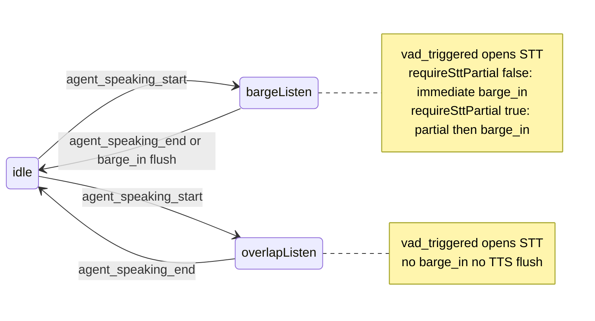

# VAD and barge-in guide

How `VoiceAgent` uses voice activity detection (VAD) and barge-in, which settings matter, and what you can leave at defaults.

Rust defaults live in `crates/speech/src/config.rs`. TypeScript mirrors them in [`src/voice/defaults.ts`](./src/voice/defaults.ts).

**API reference (exports, events, Rust modules):** [VOICE-API.md](./VOICE-API.md).

## Philosophy: defaults first

Most phone-bot / voice-assistant apps only need:

```typescript
import { VOICE_AGENT_VAD_PRESET } from '@node-webrtc-rust/sdk/voice'

const agent = new VoiceAgent({
  stt: { provider: 'deepgram' /* … */ },
  tts: { provider: 'openai' /* … */ },
  vad: VOICE_AGENT_VAD_PRESET,
  events: { mode: 'both' },
})
```

Or omit `vad` entirely and get library defaults (VAD on, barge-in on, `gateStt` off). For production voice agents that stream STT, prefer **`VOICE_AGENT_VAD_PRESET`** (`gateStt: true`).

Override a field only when you hit a concrete issue (false barge-in, STT cutting off words, TTS split into two utterances).

---

## Defaults at a glance

| Field                              | Default  | Role                                                                                                                                                        |
| ---------------------------------- | -------- | ----------------------------------------------------------------------------------------------------------------------------------------------------------- |
| `vad.enabled`                      | `true`   | Inbound VAD on                                                                                                                                              |
| `vad.provider`                     | `energy` | RMS VAD in default native build                                                                                                                             |
| `vad.threshold`                    | `0.15`   | Energy RMS default (not Silero 0.5)                                                                                                                         |
| `vad.minSpeechDurationMs`          | `250`    | Min voiced time before `user_speaking_start`                                                                                                                |
| `vad.minSilenceDurationMs`         | `1100`   | Min silence before VAD internal `SpeechEnd` (“maybe done”) — then `sttGateHoldMs` grace (default **400** ms)                                                |
| `vad.speechPadMs`                  | `300`    | Pre-roll ring size for `gateStt` (not subtracted from speech start)                                                                                         |
| `vad.gateStt`                      | `false`  | If `true`, STT only while gate is open                                                                                                                      |
| `vad.gateSttOpenOnPending`         | `true`   | Include VAD “pending” speech in gate (WebRTC lead-in)                                                                                                       |
| `vad.sttGateHoldMs`                | `400`    | After internal `SpeechEnd`, keep STT open this long; with `gateStt`, `user_speaking_end` fires when hold expires (resume speech during hold → no end event) |
| `vad.sttListenTimeoutMs`           | `4000`   | After `vad_triggered`, emit `user_stt_not_found` when no STT partial within this window (C1)                                                                |
| `vad.utteranceFinalizeTimeoutMs`   | `1500`   | Grace after last partial or VAD `SpeechEnd` before forcing `user_speech_final` when vendor final stalls (C2)                                                |
| `vad.bargeIn.enabled`              | `true`   | Allow barge-in flush + event                                                                                                                                |
| `vad.bargeIn.useVad`               | `true`   | Auto barge on VAD `SpeechStart`; with `requireSttPartial` (default), **agent TTS** waits for STT partial before flush                                       |
| `vad.bargeIn.requireSttPartial`    | `true`   | Semantic barge during agent playback — see [below](#semantic-barge-in-requiresttpartial-default-true)                                                       |
| `vad.bargeIn.flushTts`             | `true`   | Clear pending TTS PCM on barge-in                                                                                                                           |
| `vad.bargeIn.agentPlaybackGuardMs` | `0`      | **0 = barge anytime**; optional ms to ignore VAD barge right after TTS starts (speaker echo)                                                                |

**Shipped native build** uses **energy VAD** only (`provider: "energy"`). See [VAD providers](#vad-providers-energy-vs-silero) below.

---

## Inbound noise suppression (RNNoise)

Optional RNNoise runs on **stereo 48 kHz** inbound PCM **before** downsample and VAD. It reduces stationary background noise for STT; it is **not** caller isolation or echo cancellation.

| Surface                  | Config                                      | Default                              |
| ------------------------ | ------------------------------------------- | ------------------------------------ |
| `VoiceAgent`             | `noiseSuppression: { provider: 'rnnoise' }` | Off (`provider` omitted or `'none'`) |
| Conference `RoomOptions` | `noiseSuppression: 'rnnoise' \| 'none'`     | On when omitted (`'rnnoise'`)        |

```typescript
const agent = new VoiceAgent({
  noiseSuppression: { provider: 'rnnoise' },
  vad: VOICE_AGENT_VAD_PRESET,
  stt: { provider: 'deepgram' /* … */ },
})

await conference.createRoom('demo', { noiseSuppression: 'none' }) // disable mix denoise
```

RNNoise adds roughly **10 ms** algorithmic delay on the inbound path. Tune VAD/barge-in separately — denoise does not replace semantic barge-in.

---

## STT utterance lifecycle (VAD + STT events)

When `vad.enabled` is **true** and STT is configured, each VAD `SpeechStart` opens a **recognition session** — STT is **not** fed continuously during agent TTS until VAD fires. Use the lifecycle events for logging, tests, and UI that need “listening for words” vs “user is talking.”

### Event layers

| Event                                       | Layer           | When                                                                                      |
| ------------------------------------------- | --------------- | ----------------------------------------------------------------------------------------- |
| `vad_triggered`                             | VAD             | Every VAD `SpeechStart` while `vad.enabled`                                               |
| `user_stt_start` / `user_stt_end`           | STT session     | Recognition session open / closed (normal, C1, or C2)                                     |
| `stt_stream_start` / `stt_stream_end`       | STT vendor feed | PCM forwarding to the STT vendor on / off                                                 |
| `user_speaking_start` / `user_speaking_end` | VAD + gate      | User turn boundaries (`user_speaking_end` paired with `user_speech_final` when `gateStt`) |
| `user_speech_partial` / `user_speech_final` | STT text        | Streaming / final transcript                                                              |
| `barge_in`                                  | Barge           | Only while `agent_speaking == true` and `bargeIn.enabled`                                 |

**Open sequence (typical):** `vad_triggered` → `user_stt_start` → `stt_stream_start` → `user_speaking_start` (same VAD `SpeechStart`; pre-roll flush preserved when `gateStt`).

**Successful close:** `stt_stream_end` → `user_stt_end` → `user_speaking_end` → `user_speech_final`.

**`vad.enabled: false`** — no VAD, no `vad_triggered`; inbound PCM is **always** forwarded to STT (passthrough). Lifecycle events `vad_triggered`, `stt_stream_*`, and `user_stt_*` do **not** fire; you still get `user_speech_partial` / `user_speech_final` when the vendor transcribes.

### Flows during agent TTS

`barge_in` applies only while **`agent_speaking == true`** (no post-playback grace). STT opens on every VAD `SpeechStart` when VAD is on; barge only gates **interrupt + TTS flush**.



| Flow       | Config                                                            | STT on VAD         | Barge / flush                                                    |
| ---------- | ----------------------------------------------------------------- | ------------------ | ---------------------------------------------------------------- |
| **A**      | `bargeIn` on, `requireSttPartial: false`, agent speaking          | Immediate          | Same `SpeechStart` as `vad_triggered`                            |
| **B**      | `bargeIn` on, `requireSttPartial: true` (default), agent speaking | Immediate          | After qualifying `user_speech_partial` (≥ `minSttPartialTokens`) |
| **D**      | `bargeIn` off during agent TTS                                    | Immediate          | Never auto — agent keeps talking                                 |
| **Normal** | Agent not speaking                                                | On `vad_triggered` | No barge                                                         |

Event order for semantic barge (**B**): `vad_triggered` → `user_stt_start` → `stt_stream_start` → … → `user_speech_partial` → `barge_in` → `agent_speaking_end` (when `flushTts`).

### C1 — VAD but no STT partial

After `vad_triggered` + `stt_stream_start`, if **no** `user_speech_partial` within **`sttListenTimeoutMs`** (default 4000 ms):

1. `stt_stream_end`
2. `user_stt_not_found`
3. `user_stt_end`
4. **No** `user_speech_final` (nothing to reply to)

Coughs and pure tones during semantic barge often hit **C1** instead of `barge_in`.

### C2 — Partials but vendor final stalls

C2 runs only in the **end-of-turn** phase: VAD is not in `SpeechStart`, **`sttGateHoldMs` has drained**, and the user turn has ended (`SpeechEnd` or equivalent). While the user is still speaking (VAD active or gate hold open), C2 is **disarmed** — a slow partial during a long phrase must not force `user_speech_final`.

After hold drains (when `gateStt` deferred finalize on `SpeechEnd`), **`utteranceFinalizeTimeoutMs`** (default 1500 ms) arms. If the vendor final stalls:

1. `stt_stream_end`
2. `user_speaking_end` (if not already emitted)
3. `user_stt_end`
4. **`user_speech_final`** — vendor final if it arrived during finalize poll, else **last partial** text, else empty string

A **wall-clock** safety net fires the same close when inbound PCM stops entirely (RTP ended) after C2 is armed — not when the gate is closed mid-phrase or PCM is still flowing on silence frames (PCM-clock path).

**Invariant:** Any utterance with ≥1 `user_speech_partial` must eventually get `user_speaking_end` + `user_speech_final` (normal path or C2).

| Timer                            | Role                                                                                                                                                        |
| -------------------------------- | ----------------------------------------------------------------------------------------------------------------------------------------------------------- |
| **`sttGateHoldMs`**              | Keeps the STT **gate** open after internal VAD `SpeechEnd` for trailing phonemes / word gaps                                                                |
| **`utteranceFinalizeTimeoutMs`** | After hold drains at end-of-turn, forces close if vendor final stalls; disarmed during active speech                                                        |
| **`sttListenTimeoutMs`**         | After `vad_triggered` with no partial — C1 `user_stt_not_found`                                                                                             |
| **`postUtteranceSilenceMs`**     | Agent streams trailing outbound silence after TTS (~`sttGateHoldMs + minSilenceDurationMs + 250`) so remote listeners see `SpeechEnd` without relying on C2 |

Sherpa roundtrip harnesses assert these sequences — see [ROUNDTRIP.md § STT lifecycle evaluators](../../examples/voice-agent-local-sherpa/ROUNDTRIP.md#stt-lifecycle-evaluators).

---

## VAD providers (energy, adaptive, Silero)

Three backends share the same `VadConfig` timing fields (`minSpeechDurationMs`, `minSilenceDurationMs`, `speechPadMs`, barge-in, `gateStt`). Only **detection** differs.

### How to choose

| `vad.provider`         | When to use                                                                                                                                                    |
| ---------------------- | -------------------------------------------------------------------------------------------------------------------------------------------------------------- |
| **`energy`** (default) | **npm `build:native` / published binaries** — no extra deps, tune `threshold` for your mic/noise floor                                                         |
| **`adaptive`**         | Opt-in, same binary as `energy`: the threshold follows the noise floor and the caller's level (quiet callers, steady background noise)                         |
| **`silero`**           | Custom native build with `silero-vad` Cargo feature **and** `provider: "silero"` — heavier binary. **Not recommended for noisy calls** (see the warning below) |

```typescript
// Shipped binary (energy) — recommended default
vad: { ...VOICE_AGENT_VAD_PRESET, provider: 'energy', threshold: 0.15 }

// Custom Silero build only
vad: { ...VOICE_AGENT_VAD_PRESET, provider: 'silero', threshold: 0.5 }
```

If you set `provider: 'silero'` on the **stock** `.node` without rebuilding, `VoiceAgent` / `attach` fails with a config error (no silent fallback). Use `provider: 'energy'` or rebuild with `silero-vad`.

### Comparison

|                          | **Energy**                                         | **Silero**                                                                                                                                                |
| ------------------------ | -------------------------------------------------- | --------------------------------------------------------------------------------------------------------------------------------------------------------- |
| **In shipped `.node`**   | Yes (default Cargo feature `energy-vad`)           | No                                                                                                                                                        |
| **Algorithm**            | RMS of mono PCM vs `threshold`                     | Small ONNX model (~309k params), probability vs `threshold`                                                                                               |
| **Model / runtime size** | None (inline math)                                 | Model ~**1–2 MB** embedded in `silero-vad-rust`; **ONNX Runtime loaded dynamically** at runtime (not in the `.node`) — install ORT separately (see below) |
| **CPU per 20 ms frame**  | Negligible (one RMS)                               | ~**&lt;1 ms** per ~30 ms chunk (upstream Silero docs; plus ORT overhead)                                                                                  |
| **Threshold scale**      | RMS ~**0.05–0.2** (Sherpa example uses `0.05`)     | Probability ~**0.3–0.6** (default config uses `0.5` when you opt into Silero)                                                                             |
| **False triggers**       | Tones, keyboard, loud noise can look like “speech” | Generally fewer false starts in noise                                                                                                                     |
| **Tuning**               | `threshold`, `minSpeechDurationMs`                 | Same timing fields + Silero `threshold`                                                                                                                   |
| **Sample rate**          | 8 / 16 kHz via `vad.sampleRate`                    | 8 / 16 kHz (Silero backend)                                                                                                                               |

### Weight (how heavy is Silero?)

| Component              | Energy   | Silero (this repo)                                                                |
| ---------------------- | -------- | --------------------------------------------------------------------------------- |
| Extra Rust code        | A few KB | `silero-vad-rust` + `ort` crate (dynamic load only)                               |
| Embedded model         | —        | ~**1.2–2.2 MB** (v5/v6 ONNX inside `silero-vad-rust`)                             |
| **`.node` size delta** | **0**    | Modest (Rust + model bytes); **ORT is not linked into the addon**                 |
| **Runtime on disk**    | —        | **ONNX Runtime** you install yourself (~**15–50 MB** depending on platform/build) |

Published macOS arm64 `.node` today is ~**90 MB** (WebRTC, vendors, Sherpa, etc.). Sherpa already ships **its own** ONNX stack for STT/TTS; Silero VAD uses a **second** ONNX Runtime via `ort` — we do **not** bundle that into npm artifacts.

> **Warning:** Silero treats continuous background voices as speech and does not end turns in babble (measured in a CI run with a babble bed), so it is not recommended for noisy calls. It is not in the default build.

**Status:** `silero-vad` is an optional feature on `node-webrtc-rust-speech` and `node-webrtc-rust-bindings`. Default npm / CI builds use **energy only**. Silero is **documented, opt-in, not CI-shipped** (ORT + model size).

### Enabling Silero (maintainers / custom builds)

There is **no** runtime toggle: one VAD backend per compiled `.node`.

#### 1. Install ONNX Runtime locally (required)

Silero uses the [`ort`](https://crates.io/crates/ort) crate with **`load-dynamic`**: at runtime the process must find **`libonnxruntime.dylib`** (macOS), **`libonnxruntime.so`** (Linux), or **`onnxruntime.dll`** (Windows). We **do not** download or copy ORT into the published `.node`; custom-build operators install it on each machine / image.

**Version:** speech pins `ort = 2.0.0-rc.10`, which targets **ONNX Runtime 1.22**. Use a 1.22-compatible install when possible (newer minors are often fine; mismatches show up as load or inference errors).

**Not Sherpa’s ONNX:** the default bindings build already includes ONNX inside `sherpa-onnx` for local STT/TTS. That runtime is **not** shared with Silero VAD — you still need a separate ORT install for `provider: 'silero'`.

**macOS (Homebrew example):**

```bash
brew install onnxruntime
export DYLD_LIBRARY_PATH="$(brew --prefix onnxruntime)/lib:${DYLD_LIBRARY_PATH:-}"
```

**Linux:** install from your distro if available, or unpack a [Microsoft ONNX Runtime release](https://github.com/microsoft/onnxruntime/releases) (CPU build is enough for VAD) and point the loader at the `lib/` directory:

```bash
export LD_LIBRARY_PATH="/path/to/onnxruntime/lib:${LD_LIBRARY_PATH:-}"
```

**Windows:** add the directory containing `onnxruntime.dll` to `PATH`.

**Verify before running Node** (optional):

```bash
# macOS — should print a path, not "no such file"
ls "$(brew --prefix onnxruntime)/lib/libonnxruntime.dylib" 2>/dev/null || ls libonnxruntime.dylib
```

If ORT is missing, the first Silero inference typically fails with an error like `dlopen(libonnxruntime.dylib, …): tried: … (no such file)`.

**Deploying custom builds:** document ORT installation for your team (same as above), or bake ORT into your container/AMI. We intentionally avoid bundling ORT in npm to keep default artifacts smaller; static/bundled ORT remains a possible future maintainer choice (`ort` features `download-binaries` + `copy-dylibs`) at the cost of a much larger per-platform binary.

#### 2. Build native with `silero-vad`

Speech pins `ort = 2.0.0-rc.10` for `silero-vad-rust` compatibility:

```bash
cd node-webrtc-rust
npm run build:native -- --features silero-vad
```

Or enable `features = ["silero-vad"]` on the bindings crate in `packages/bindings/Cargo.toml`, then `npm run build:native`.

Run your app with the same `DYLD_LIBRARY_PATH` / `LD_LIBRARY_PATH` / `PATH` you used when testing.

#### 3. Configure the agent

```typescript
vad: { ...VOICE_AGENT_VAD_PRESET, provider: 'silero', threshold: 0.5, sampleRate: 16000 }
```

### Adaptive energy VAD

`provider: 'adaptive'` is the energy VAD with a threshold that moves. `"energy"` stays the default and behaves exactly as before.

How it works, per 20 ms frame (mono 16 kHz, the same signal the energy VAD sees):

1. The frame level is its RMS in dBFS.
2. For the first `warmupMs` the plain energy rule decides (`vad.threshold`), so the start of a call is never worse than `energy`. Frames judged quiet feed the noise window.
3. The **noise level** is the `noisePercentile` (70) of the levels of the last `noiseWindowMs` (3 s) of frames judged quiet. If an utterance stays open longer than `stuckActiveMs` (8 s), its active frames also feed the noise window until the utterance ends, so a level step in the background noise cannot hold the VAD open. A caller who speaks without pausing for longer than this can be cut off; raise it for monologue-style use.
4. The **caller level** is a slow average (factor 0.05) of the active frames after warm-up.
5. The **threshold** is noise + `noiseMarginDb` (6 dB). With `useSpeechLevel`, and when the caller is more than twice the margin above the noise, it is raised to halfway between noise and caller. It is clamped to `minThresholdDbfs`..`maxThresholdDbfs`.
6. A frame starts speech at the threshold and stays active down to `hysteresisDb` (3 dB) below it, so word gaps do not split an utterance.

Minimum speech and silence, pre-roll and barge-in work as for `energy`. Set `VOICE_DEBUG=1` to log the threshold, noise and caller levels at every speech start.

```typescript
vad: { ...VOICE_AGENT_VAD_PRESET, provider: 'adaptive', adaptive: { noiseMarginDb: 6 } }
```

| `vad.adaptive.*`   | Default | Range              | Meaning                                                                 |
| ------------------ | ------- | ------------------ | ----------------------------------------------------------------------- |
| `warmupMs`         | `400`   | 0..`noiseWindowMs` | Start of the call decided by `vad.threshold`                            |
| `noiseWindowMs`    | `3000`  | >= 500             | Window the noise level is read from                                     |
| `noisePercentile`  | `70`    | 1..99              | Percentile of that window taken as noise                                |
| `noiseMarginDb`    | `6`     | 0..30              | Speech must be this far above the noise                                 |
| `useSpeechLevel`   | `true`  |                    | Raise the threshold toward the caller's level                           |
| `hysteresisDb`     | `3`     | 0..30              | Stay active this far below the threshold                                |
| `minThresholdDbfs` | `-50`   | < max              | Lower clamp of the threshold                                            |
| `maxThresholdDbfs` | `-10`   | <= 0               | Upper clamp of the threshold                                            |
| `stuckActiveMs`    | `8000`  | >= 1000            | An utterance open this long feeds its active frames to the noise window |

The defaults (`noiseMarginDb` 6, `useSpeechLevel` true) come from bench run 5. With `adaptive`, `vad.threshold` only matters during warm-up.

Bench results (main caller at −20 dBFS, raw audio, one bystander at the given level below the caller):

| Bystander | `energy`: oracle / onset | `adaptive`: oracle / onset | `adaptive` merged / missed turns |
| --------- | ------------------------ | -------------------------- | -------------------------------- |
| −20 dB    | 50 % / 706 ms            | **100 % / 74 ms**          | 0 / 0                            |
| −15 dB    | 50 % / 654 ms            | **100 % / 77 ms**          | 0 / 0                            |
| −10 dB    | 75 % / 554 ms            | 75 % / 194 ms              | 2 / 2                            |
| −6 dB     | 50 % / 574 ms            | 75 % / 144 ms              | 1 / 2                            |

Use `adaptive` for quiet callers; a bystander within about 10 dB of the caller can merge or split turns (accepted limit, not tuned).

**When to use it:** a caller who is quiet or far from the mic (the fixed threshold never fires), or a noise level that differs per call (the fixed threshold is either too high or too low).

**Caveat:** it follows level, not voice. A bystander who is louder than the caller is still speech. Telling voices apart is the job of the speaker gate, not of the VAD.

### Which should I use?

| Situation                                                                     | Recommendation                                                                         |
| ----------------------------------------------------------------------------- | -------------------------------------------------------------------------------------- |
| Default npm package, demos, Sherpa local example                              | **`energy`** + `VOICE_AGENT_VAD_PRESET`; tune `threshold` (Sherpa uses `0.05`)         |
| Noisy office, fan, music bleed, false barge-in                                | Try `adaptive`, or a higher `minSpeechDurationMs`; Silero is not recommended in babble |
| Quiet or distant caller that the fixed `threshold` misses                     | **`adaptive`**                                                                         |
| Maximum simplicity, CI, edge devices                                          | **Energy**                                                                             |
| You control native builds, can install ORT locally, and want best VAD quality | **Silero** custom build                                                                |

---

## Speaker gate

Opt-in (`speakerGate.enabled`, off by default). It stops a second voice on the same microphone from interrupting the agent or passing as the caller.

```ts
vad: { ...VOICE_AGENT_VAD_PRESET, provider: 'adaptive' },
speakerGate: { enabled: true, modelPath: '/models/speaker/nemo_en_titanet_small.onnx' }
```

How it works:

- **Enrollment.** The agent learns the caller's voice from their first `enrollSpeechMs` of speech (default 3000 ms). Until then every utterance is `speaker: 'unknown'` and nothing changes.
- **Check.** Each later utterance is compared with the enrolled voice using `checkSpeechMs` of its speech (default 1500 ms, `minCheckSpeechMs` 1500 ms). The cosine score must reach `threshold` (default 0.459, TitaNet-small). The check costs about 20 ms of CPU and runs off the audio path.
- **Barge-in delay.** While the agent speaks and a voice is enrolled, a barge-in waits for the verdict. The caller therefore interrupts at the later of `checkSpeechMs` after they start speaking and the first partial with `minSttPartialTokens` tokens when `requireSttPartial` is on (the roundtrip asserts within 300 ms of that). A voice that does not match never barges in. Turn the gate off if you need instant barge-in.
- **`flag` or `drop`.** `onMismatch: 'flag'` (default) keeps the final and sets `speaker: 'other'` on it. `'drop'` replaces it with `user_speech_ignored` (`reason: 'speaker_mismatch'`, no text). Clips shorter than `minCheckSpeechMs` (reason `short`), and any check that fails or exceeds `verifyTimeoutMs`, are `speaker: 'unknown'` and behave as without the gate, so a stuck gate never mutes the real caller.
- **Re-check after `other`.** When the first check says `other` and the utterance keeps going, the gate keeps checking the next `checkSpeechMs` of speech, up to `recheckMaxWindows` windows (`recheckOnOther`, default `true`). See [Re-check after other](#re-check-after-other-recheckonother).
- **Minimum check length.** `minCheckSpeechMs` defaults to 1500 ms. Shorter utterances are not scored and stay `unknown`; see [Minimum check length](#minimum-check-length-mincheckspeechms-why-1500-ms) for the numbers and the trade-off.
- **`resetSpeakerEnrollment()`** forgets the voice, for example when another person takes over the line. The next utterances enroll again.

Recommended with `vad.provider: 'adaptive'`. With the energy VAD, turns in background noise split into short pieces, which are more often `unknown`.

Limit: a bystander about as loud as the caller can pass the check; the gate is tested with bystander turns 6 dB below the caller (the two long turns of the noisy-bystander roundtrip) and 15 dB below (the other turns), over babble. Turns from two people less than about 1.5 s apart end up in one transcript, labelled by the check of its first speaker, because the agent's end of turn waits that long for more speech. Other speech that opens the VAD and runs into the caller's words without a pause fills the first check window, so the first check says other. The gate keeps re-checking while the verdict stays other, so other speech that leads the caller by up to about `(recheckMaxWindows − 2) × checkSpeechMs` (9 s with the defaults) no longer hides the caller. A longer lead still does, and `recheckMaxWindows: 0` removes the cap at the false-accept cost in the table below. With `recheckOnOther: false` the barge-in stays suppressed and the final is labelled other.

### Re-check after other (`recheckOnOther`, `recheckMaxWindows`)

A TV or a colleague talking right before the caller can open the VAD, and if the caller starts before that speech pauses, both end up in one utterance. The first 1.5 s window then holds mostly the other voice and scores `other`. Without another look the caller would be ignored for that whole utterance.

With `recheckOnOther` on (the default), the gate scores the following windows of the same utterance, each `checkSpeechMs` of fresh speech with the same model and threshold, until one says `caller` or `recheckMaxWindows` windows have been scored (default 8, the first check included, so 12 s of speech with the defaults). `recheckMaxWindows: 2` gives the 0.15.0 behaviour of a single re-check, `0` removes the cap, and `1` is rejected (use `recheckOnOther: false`). The rules are narrow on purpose:

- Re-checking runs only while the verdict is `other`. A `caller` or `unknown` verdict is never re-checked, so a bystander who joins a caller's utterance cannot relabel it.
- It can only turn `other` into `caller`. Once a window says `caller`, the held barge-in fires for that utterance (same `utteranceId`) and the final says `speaker: 'caller'`. If every window says `other`, a check fails, or the utterance ends before the next window fills, the verdict stays `other` and there is no barge-in.
- A barge-in released by the n-th window comes no earlier than n × `checkSpeechMs` of speech (3 s for the second window and 12 s for the eighth, with the defaults). The final reports n as `speakerCheckWindows`, and the SDK exports the bound as `speakerRecheckBargeEarliestMs(checkSpeechMs, window)`. The n × `checkSpeechMs` bound holds for re-check windows (n ≥ 2). The first check follows `minCheckSpeechMs` as in 0.15.0: when `minCheckSpeechMs` is below `checkSpeechMs`, a short utterance's first check at the end of its speech can release a barge-in before 1 × `checkSpeechMs`.
- The final reports `speakerRechecked: true` whenever a re-check was scored before it, with `speaker` set to the combined verdict.
- A final waits for a re-check that is still running, bounded by `verifyTimeoutMs` like the first check. A final that has read its verdict stops any later re-check of its utterance. If the final stopped waiting (`verifyTimeoutMs`), it says `other` and a later re-check result never barges in.
- The next window starts only once the previous verdict is in. If a verdict arrives after the utterance has ended (a slow or backlogged speaker model), no further window runs, and the final stays `other` with no barge-in.
- A barge-in held for a re-check fires only into the reply that was playing when it was held. If that reply has ended, or a new one has started, the held barge-in is dropped, because it no longer has anything to interrupt. A caller verdict that lands after the agent stopped speaking only labels the final (`speaker: 'caller'`, `speakerRechecked: true`) and sends no `barge_in`.
- A held barge-in always arrives before the final of its own utterance, never after it.
- A first check that times out fails open: the verdict is `unknown` (reason `timeout`), not `other`, so the barge-in is not suppressed and no re-check follows.

The cost is exposure: a long bystander utterance gets one more chance to pass for every extra window. We measured it on long streams of bystander speech and babble, stitched from four scenes, about 16 s each, with the voice changing every 4 s (TitaNet-small, threshold 0.459, `speaker_bench --long-other`, 2026-10-31, pooled n = 480). The false-accept rate (FAR) of consecutive windows by seconds of other speech:

| other speech | windows | FAR    |
| ------------ | ------- | ------ |
| 1.5 s        | 1       | 0.21 % |
| 3 s (0.15.0) | 2       | 0.42 % |
| 6 s          | 4       | 1.25 % |
| 9 s          | 6       | 1.46 % |
| 12 s         | 8       | 2.29 % |
| 15 s         | 10      | 3.33 % |

That is about 0.2 points per extra window. The cap trades this against how long a lead the gate forgives, because each window is all-or-nothing on it. Caller recall after other speech that leads by k seconds (test set, n = 96):

| caller starts after | cap 2 (0.15.0) | cap 4 | cap 6 | cap 8 (default) |
| ------------------- | -------------- | ----- | ----- | --------------- |
| 1 s                 | 78 %           | 79 %  | 79 %  | 79 %            |
| 2 s                 | 45 %           | 89 %  | 89 %  | 89 %            |
| 3 s                 | 0 %            | 95 %  | 95 %  | 95 %            |
| 4 s                 | 0 %            | 77 %  | 78 %  | 78 %            |
| 6 s                 | 0 %            | 0 %   | 91 %  | 91 %            |
| 9 s                 | 0 %            | 0 %   | 0 %   | 92 %            |

The 1 s row stops at 79 % partly because some caller clips are too short for any window to end after the onset. Treat the numbers with care: each stitched stream changes voice every 4 s, so one bystander voice that sounds close to the caller would be accepted more often than the table says, and the four references are the same voice at four levels, so the trials are correlated and the effective sample is smaller than 480.

Overlap does not change much. With the other speech mixed in under the caller for 1 s, 3 s or the whole clip, recall moves by at most about 3 points. A bystander at recording level (the raw recordings' scale, not matched to the caller) talking over the caller costs 0 to 3 points at a cap of 6 or more, and early false accepts do not depend on the overlap. That is a bystander at recording level, not one measured as equally loud as the caller.

A sliding scheme (a check every 500 ms) recalls 92 to 97 % with 1.0 to 1.5 s latency, but needs about three times the windows for the same lead and has a false-accept rate three to six times higher, so the gate uses consecutive windows. Embedding one 1.8 s clip takes 19 ms at the median (35 ms at p99) on one thread; a 17 s utterance with the default cap costs 0.15 s of CPU in total. Set `recheckOnOther: false` to keep exactly one check per utterance.

### Minimum check length (`minCheckSpeechMs`): why 1500 ms

`minCheckSpeechMs` is the least speech an utterance needs before the gate scores it. We measured how it trades off false rejects of the real caller (FRR) against false accepts of a bystander (FAR). Setup: TitaNet-small, threshold 0.459 fixed, `speaker_bench` Part 1, 128 genuine and 92 impostor clips per set, the bystander at -6, -10, -15 and -20 dB re the caller pooled (measured 2026-10-30).

| check length | set  | FRR    | FAR   |
| ------------ | ---- | ------ | ----- |
| 1.0 s        | test | 11.7 % | 0.0 % |
| 1.0 s        | tune | 18.0 % | 1.1 % |
| 1.25 s       | test | 3.1 %  | 0.0 % |
| 1.25 s       | tune | 7.8 %  | 1.1 % |
| 1.5 s        | test | 0.8 %  | 0.0 % |
| 1.5 s        | tune | 1.6 %  | 2.2 % |

At 1.25 s, FRR per bystander level, test (tune): -6 dB 9.4 % (21.9 %), -10 dB 3.1 % (9.4 %), -15 dB 0 % (0 %), -20 dB 0 % (0 %). A bystander nearly as loud as the caller is where short clips fail most.

**What happens to an utterance below the minimum.**

1. While the utterance is live and has no verdict, a barge-in attempt is deferred and the agent keeps talking.
2. The utterance ends with less speech than `minCheckSpeechMs`. It is not scored: the verdict is `unknown`, and the final carries `speaker: 'unknown'` and `speakerUnknownReason: 'short'`.
3. The deferred barge-in is released at that moment. A short phrase that already met the normal barge-in rules (the agent is speaking, and a partial with at least `minSttPartialTokens` words arrived) therefore interrupts at the end of the phrase, not at its start.
4. This holds for the caller and a bystander alike. A short bystander phrase can interrupt the agent, because the gate never looked at it.

**Why not shorter.** At 1.0 s, 11.7 % of genuine caller clips on the test set (18.0 % on tune) fall below the threshold, so about one caller in nine would be told `other` and ignored. At 1.25 s the test FRR is 3.1 % overall and 9.4 % when the bystander is almost as loud (-6 dB), still too many for a gate whose job is to protect the caller's own turn. At 1.5 s the test FRR is 0.8 %. The price of 1500 ms is the short-utterance gap described above.

| `minCheckSpeechMs` | caller                                                                              | bystander                                                       |
| ------------------ | ----------------------------------------------------------------------------------- | --------------------------------------------------------------- |
| 1000               | most short phrases are checked, but about 12 % of checked caller clips are rejected | short bystander phrases are checked and suppressed              |
| 1250               | 3 % rejected (9 % next to a loud bystander)                                         | phrases of 1.25 s or more are checked                           |
| 1500 (default)     | under 1 % rejected; phrases under 1.5 s are unchecked and barge in at their end     | phrases under 1.5 s are unchecked and can barge in at their end |

**`speakerUnknownReason`.** `user_speech_final` carries it whenever the gate is on and `speaker` is `'unknown'`, in the same event. It tells an app "too short to check" apart from a failed check: `short` (less speech than `minCheckSpeechMs`), `timeout` (the check or the wait for it exceeded `verifyTimeoutMs`), `error` (the embedding call failed), `no_embedding` (no embedding or no score), `not_enrolled` (no reference voice yet), `no_check` (enrolled, but no check was sent). It is absent for `caller` and `other`. Only `short` is affected by the option below; every other unknown still lets the barge-in through, so a stuck gate never mutes the caller.

**`suppressShortBargeIn` (opt-in, default `false`).** When `true`, an utterance whose verdict is `unknown` with reason `short` suppresses its barge-in like `other` does, including the deferred one released at its end. Use it where background voices are loud and you would rather ignore a short phrase than let a bystander interrupt, for example an open-plan office. The cost: short caller phrases such as "stop" no longer interrupt the agent. They are still transcribed, and their final still arrives with `speaker: 'unknown'`.

**Tuning per project.** Lower `minCheckSpeechMs` (towards 1250) only if your callers say many short interruptions and a bystander rarely talks over them. Keep 1500 or raise it where bystanders are loud and you want fewer false accepts. Pair it with `suppressShortBargeIn: true` when short bystander phrases must never interrupt. `checkSpeechMs` below `minCheckSpeechMs` is rejected at config time.

**Reproduce the table.** Generate the scenes once, then run Part 1 at the fixed threshold (Parts 2 and 3 are skipped). Paths are examples; the speaker model comes from `npm run download-speaker --workspace=@node-webrtc-rust/example-voice-agent-local-sherpa`.

```bash
cargo run --release -p node-webrtc-rust-vendor-sherpa-onnx --example speaker_fixtures -- \
  --models examples/voice-agent-local-sherpa/.models/speaker \
  --main-tts examples/voice-agent-local-sherpa/.models/vits-piper-en_US-amy-low \
  --phrases examples/voice-agent-local-sherpa/stt-phrase-qualification.json \
  --out /tmp/speaker-fixtures
cargo run --release -p node-webrtc-rust-vendor-sherpa-onnx --example speaker_bench -- \
  --fixtures /tmp/speaker-fixtures \
  --models examples/voice-agent-local-sherpa/.models/speaker \
  --stt-model <zipformer dir> --out /tmp/speaker-bench \
  --checks 1.0,1.25,1.5 --fixed-threshold 0.459
```

The per-set FRR and FAR per level are written to `/tmp/speaker-bench/part1_fixed.md`.

`barge_in` carries the `utteranceId` of the utterance that interrupted, so an app can tell which turn it belongs to.

Privacy:

- A voice embedding is biometric data (special-category data under GDPR Art. 9 when it identifies a person). Embeddings stay in process memory: they are never logged, put in events, metrics or traces, stored, or sent anywhere, and they are gone when the agent stops.
- The feature is opt-in. Tell your users that their voice is analyzed during the call and obtain the consent your jurisdiction requires.
- The speaker model is your choice and its license applies. The recommended `nemo_en_titanet_small.onnx` is NVIDIA NeMo TitaNet-small, published under the NeMo Toolkit license (Apache-2.0); check the license of any other model you use.

**Recognizer limit under background chatter.** The bundled Sherpa recognizer can mishear a short phrase with a weak onset when other people talk about 15 dB below the caller: "excuse me" came out as "X cuse" in a noisy-bystander test. The scene tests in this repo therefore only judge phrases that met the test's word-similarity threshold (0.75) in 1000 of 1000 syntheses under that condition, at both caller levels.

## Use cases

### 1. Standard voice agent (one peer, user talks, agent replies)

**One `VoiceAgent`** on the call:

- `inboundTrack` = user mic (remote)
- `outboundTrack` = agent TTS (local)
- **VAD + barge-in + `gateStt`** on this agent

```typescript
vad: VOICE_AGENT_VAD_PRESET
// or: { gateStt: true }  // everything else default
```

| Piece           | Setting                   | Why                                                                         |
| --------------- | ------------------------- | --------------------------------------------------------------------------- |
| VAD             | `enabled: true` (default) | Utterance boundaries, barge-in                                              |
| `gateStt`       | `true`                    | Don’t stream silence/noise to STT                                           |
| `bargeIn`       | defaults (`useVad: true`) | User can talk over TTS                                                      |
| `sttGateHoldMs` | default `400`             | Bridge word gaps; see [STT flow fine-tuning](#stt-flow-fine-tuning-gatestt) |

**App wiring:**

```typescript
agent.on('user_speech_final', (e) => startLLM(e.text!))
agent.on('barge_in', () => cancelLLM())
```

You do **not** need a second agent for barge-in on a normal client.

---

### 2. Listen-only leg (STT roundtrip, conference listener)

Agent **receives** audio but **does not** play TTS on the same instance (or never calls `sendTextToTTS`).

```typescript
vad: {
  gateStt: true,
  bargeIn: { enabled: false }, // optional: no TTS to interrupt
}
```

| Piece             | Setting | Why                                      |
| ----------------- | ------- | ---------------------------------------- |
| `bargeIn.enabled` | `false` | No outbound TTS → barge-in has no effect |
| `gateStt`         | `true`  | STT only during speech                   |

Example: [`examples/voice-agent-local-sherpa` roundtrip](../../examples/voice-agent-local-sherpa/ROUNDTRIP.md) — **speaker** has `vad.enabled: false`; **listener** uses `VOICE_AGENT_VAD_PRESET`.

---

### 3. Separate TTS speaker + STT listener (two peers)

Used in tests and some pipelines:

| Peer                    | VAD                               | Barge-in         | Notes                                |
| ----------------------- | --------------------------------- | ---------------- | ------------------------------------ |
| **Speaker** (plays TTS) | `enabled: true`, `gateStt: false` | `useVad: true`   | Inbound = interrupt audio (user leg) |
| **Listener** (STT only) | `gateStt: true`                   | `enabled: false` | Does **not** stop speaker TTS        |

Barge-in only cuts TTS on the agent that **plays** audio and **hears** the interrupt on **inbound**.

---

### 4. Manual interrupt only (no VAD-driven barge)

Push-to-talk, hardware mute, or your own cloud VAD:

```typescript
vad: {
  ...VOICE_AGENT_VAD_PRESET,
  bargeIn: { enabled: true, useVad: false, flushTts: true },
}
```

Call `agent.flushTts()` when **you** decide to interrupt. Inbound tones/noise will **not** auto-cut TTS.

`user_speaking_start` / `end` still fire if VAD stays enabled.

---

### 5. Disable barge-in, keep VAD events

Agent never plays TTS, or you handle overlap in the UI only:

```typescript
vad: {
  gateStt: true,
  bargeIn: { enabled: false },
}
```

---

### 6. Disable VAD entirely

Always-on STT (rare, higher cost):

```typescript
vad: {
  enabled: false
}
```

No `user_speaking_*`, no `vad_triggered` / `stt_stream_*` / `user_stt_*`, no VAD-driven `barge_in`. STT receives **all** inbound PCM (vendor permitting). Manual barge still works via `flushTts()` when `bargeIn.useVad: false`.

---

## Barge-in reference

**Barge-in** = stop pending agent TTS and emit `barge_in` so the app can cancel the LLM stream.

```typescript
bargeIn: {
  enabled: true,
  useVad: true,
  flushTts: true,
  requireSttPartial: true, // default — semantic interrupt (see below)
  minSttPartialTokens: 2, // ≥2 words; legacy minSttPartialChars maps here
  agentPlaybackGuardMs: 0,
}
```

| `enabled` | `useVad` | What happens                                                 |
| --------- | -------- | ------------------------------------------------------------ |
| `false`   | —        | No `barge_in`, no TTS flush from barge path                  |
| `true`    | `true`   | **Automatic** while agent TTS plays (`vad.enabled` required) |
| `true`    | `false`  | **Manual** via `flushTts()` only                             |

### Semantic barge-in (`requireSttPartial`, default **true**)

While **agent TTS is playing** (`agent_speaking == true`) and STT is configured:

1. VAD `SpeechStart` → `vad_triggered` → `user_stt_start` → `stt_stream_start` (STT opens on VAD, not continuous pre-VAD feed).
2. **`user_speech_partial` must precede `barge_in`** in the event stream — coughs and tones that do not transcribe emit `user_stt_not_found` (C1) instead of interrupting playback. Mid-word fragments below `minSttPartialTokens` (default **2**) also do not barge.
3. First qualifying **`user_speech_partial`** (≥ `minSttPartialTokens` whitespace tokens) → flush TTS → `barge_in` → `agent_speaking_end` (once per playback).

When `bargeIn.enabled` is **false** during agent TTS, step 1 still runs (overlap listen) but **no** `barge_in` or TTS flush.

When `requireSttPartial: false` and barge is enabled, step 3 runs immediately on the same VAD `SpeechStart` (no wait for STT text).

When the agent is **not** speaking, VAD opens STT normally; no barge unless configured for instant path without partial.

**Caveats:**

| Topic            | Detail                                                                                                                                                                          |
| ---------------- | ------------------------------------------------------------------------------------------------------------------------------------------------------------------------------- |
| **Latency**      | Interrupt happens after the first partial (~200–800 ms+), not at the first voiced frame.                                                                                        |
| **STT required** | Without `stt` on the agent, instant VAD barge still applies when `requireSttPartial: false`.                                                                                    |
| **Echo**         | Speaker bleed can still yield partials that match agent wording; use headphones, `gateStt`, or raise `agentPlaybackGuardMs`.                                                    |
| **Disable**      | `requireSttPartial: false` restores instant energy-VAD barge (noisier).                                                                                                         |
| **C1 / C2**      | `sttListenTimeoutMs` (4000) closes listen with `user_stt_not_found`; `utteranceFinalizeTimeoutMs` (1500) forces `user_speech_final` from last partial when vendor final stalls. |

E2E: `npm run start:roundtrip-barge-in` — tone must **not** barge; spoken TTS phrase must barge.

### TTS enqueue: blocking vs non-blocking

`sendTextToTTS` (Rust: `send_text_to_tts`) defaults to **blocking**: the Promise resolves after **synthesis and outbound playback** for that utterance finish (same ergonomics as before the synthesis queue refactor).

Pass **`{ nonBlocking: true }`** when you want to enqueue and return immediately — for example parallel multi-client broadcast:

```typescript
await Promise.all(contexts.map((ctx) => ctx.speak(text, { nonBlocking: true })))
```

Cross-session ONNX work is still capped by `SHERPA_POOL_MAX_CONCURRENT_TTS` (Sherpa engine pool). Per-session utterances always synthesize and play in FIFO order.

### Non-interruptible utterances (`interruptible: false`)

`sendTextToTTS(text, { interruptible: false })` (Rust: `SendTextToTtsOptions { interruptible: false, .. }`) protects one utterance from barge-in. While that job synthesizes or plays, VAD barge-in and STT-partial barge-in are suppressed: TTS is not flushed, the synthesis queue is not cancelled, and neither `barge_in` nor `agent_speaking_end` is emitted. VAD and `user_speaking_*` events are unchanged. Utterances queued after the protected one remain interruptible, and a barge-in that fired while the protected job played is not replayed when it ends. Explicit `flushTts()`, `stop()` and `updateTts(..., { cancelInflight: true })` still cancel it. Default is `interruptible: true`.

**Requirements for auto barge:**

1. Same `VoiceAgent` that calls `sendTextToTTS`
2. `vad.enabled: true`
3. Real user speech on `inboundTrack` (not agent TTS loopback on that track)

---

## STT flow fine-tuning (`gateStt`)

Use this when you stream STT through `VoiceAgent` with **`gateStt: true`** (`VOICE_AGENT_VAD_PRESET`). The agent does not send every PCM frame to STT — only while the **gate** is open.

### End-to-end timeline (one user utterance)

1. **`minSpeechDurationMs`** — voiced audio must exceed this before VAD `SpeechStart`.
2. On `SpeechStart`: **`vad_triggered`** → **`user_stt_start`** → **`stt_stream_start`** → **`user_speaking_start`** (+ optional `barge_in` if agent TTS + barge config — see [STT utterance lifecycle](#stt-utterance-lifecycle-vad--stt-events)).
3. User speaks; STT receives audio while the stream is open (plus **`speechPadMs`** pre-roll on `SpeechStart` when `gateStt`).
4. **`minSilenceDurationMs`** — continuous silence triggers VAD `SpeechEnd` **internally** (not necessarily `user_speaking_end` yet).
5. **`sttGateHoldMs`** — gate stays open; STT still receives frames. If the user speaks again, hold **resets** and the utterance continues. C2 finalize timer starts **after** hold drains when partials were emitted.
6. When hold reaches **0** → **endpoint tail** (~`max(minSilenceDurationMs, 800)` ms synthetic silence) → **`finalize_utterance`** → **`stt_stream_end`** → **`user_stt_end`** → **`user_speaking_end`** immediately before **`user_speech_final`** (same poll; gate stays open until final). If the vendor final stalls, **`utteranceFinalizeTimeoutMs`** forces the same close sequence using the last partial (**C2**).
7. Your app runs LLM/TTS on `user_speech_final`.

**Rough reply latency after the user stops** (no resume during hold):

`minSilenceDurationMs` + `sttGateHoldMs` + endpoint tail (400–600 ms, from `minSilence`) + STT/TTS work.

With defaults: ~300 + 400 + 800 ≈ **1.5 s** before finalize, plus synthesis.

### Knobs and what they affect

| Field                            | Default                                      | Primary effect                                                                       | ↑ increase tends to…                                      | ↓ decrease tends to…                                |
| -------------------------------- | -------------------------------------------- | ------------------------------------------------------------------------------------ | --------------------------------------------------------- | --------------------------------------------------- |
| **`threshold`**                  | `0.15` (energy)                              | What counts as “speech” vs noise                                                     | Fewer false starts in noise; may miss quiet talkers       | More sensitive mic; more false STT/barge-in         |
| **`minSpeechDurationMs`**        | `250`                                        | Ignore short blips before `SpeechStart`                                              | Fewer cough/click triggers; slightly slower barge-in      | Faster barge-in; more noise triggers                |
| **`minSilenceDurationMs`**       | `1100`                                       | Pause before internal `SpeechEnd` / hold starts (“maybe done”)                       | Fewer splits on word gaps & counting; slower “maybe done” | Faster turn end; risk splitting one sentence        |
| **`sttGateHoldMs`**              | `400`                                        | How long STT stays open after that pause; when `user_speaking_end` fires (`gateStt`) | Capture slow talkers & long digit gaps; **more dead air** | **Snappier** bot; risk cutting trailing syllables   |
| **`speechPadMs`**                | `300`                                        | Pre-roll bytes fed at `SpeechStart` (`gateStt`)                                      | More lead-in audio to STT; slightly more memory           | Risk clipping first syllable                        |
| **`gateSttOpenOnPending`**       | `true`                                       | STT during VAD “pending” before `SpeechStart`                                        | Better first-word capture on WebRTC                       | Slightly more noise to STT before confirmed speech  |
| **`gateStt`**                    | `false` in lib default; **`true` in preset** | Master STT gating                                                                    | Less noise to STT; deferred `user_speaking_end`           | STT always on; immediate `user_speaking_end` on VAD |
| **`sttListenTimeoutMs`**         | `4000`                                       | C1: no partial after `vad_triggered` → `user_stt_not_found`                          | Longer tolerance for slow STT before “no speech”          | Faster C1; may false-close quiet talkers            |
| **`utteranceFinalizeTimeoutMs`** | `1500`                                       | C2: grace after hold + last partial before forced `user_speech_final`                | More time for vendor final; slower turn boundary          | Snappier forced final; risk truncating slow STT     |

**While agent TTS is playing:** inbound VAD `SpeechEnd` does **not** arm gate hold (avoids splitting on TTS word gaps in the mic path). Barge-in still uses `SpeechStart` on the user mic. STT opens on **`vad_triggered`**, not on every frame during agent playback.

### Symptom → tune (quick)

| Symptom                                                           | Try first                                                                                                      |
| ----------------------------------------------------------------- | -------------------------------------------------------------------------------------------------------------- |
| Bot silent too long after user stops                              | Lower **`sttGateHoldMs`** (600–800), then **`minSilenceDurationMs`** (200–250)                                 |
| One sentence → two `user_speech_final`                            | Raise **`minSilenceDurationMs`** (1200–1500) or **`sttGateHoldMs`** (1200–1500)                                |
| Counting / “one, two, three…” splits or early `user_speaking_end` | Raise **`minSilenceDurationMs`** (1200+); keep **`sttGateHoldMs`** ~1000–1400 so digit gaps don’t end the turn |
| Last word clipped in transcript                                   | Raise **`sttGateHoldMs`** (1200–1500) or endpoint tail (via higher **`minSilenceDurationMs`**)                 |
| Call center / floor noise triggers STT                            | Raise **`threshold`** and **`minSpeechDurationMs`**; consider Silero build; **avoid** debug `threshold: 0.01`  |
| Quiet mic, never starts                                           | Lower **`threshold`** (energy: try `0.05`–`0.08` on Sherpa demos only)                                         |

### Example presets (starting points)

| Deployment                         | `threshold` | `minSpeech` | `minSilence` | `sttGateHold` | Notes                                                                                                       |
| ---------------------------------- | ----------- | ----------- | ------------ | ------------- | ----------------------------------------------------------------------------------------------------------- |
| **Interactive bot** (preset)       | `0.15`      | `250`       | `1100`       | `400`         | `VOICE_AGENT_VAD_PRESET` — ~1.1 s maybe-done + 400 ms gate hold                                             |
| **Low-latency**                    | `0.15`      | `200`       | `250`        | `600–800`     | Snappier; test clipping                                                                                     |
| **Deliberate speech / counting**   | `0.15`      | `250`       | `450–600`    | `800–1200`    | Wider word gaps OK                                                                                          |
| **Noisy line / call center**       | `0.10–0.20` | `300–400`   | `400–500`    | `1000–1500`   | Tune threshold on real audio; AEC/headset                                                                   |
| **Sherpa local demo (quiet room)** | `0.05`      | `250`       | `300`        | `1000`        | See [local Sherpa](#local-sherpa-on-device)                                                                 |
| **Roundtrip harness** (strict)     | `0.05`      | `250`       | `300`        | `1000–2000`   | May need longer hold for loopback; see [ROUNDTRIP.md](../../examples/voice-agent-local-sherpa/ROUNDTRIP.md) |

### Env overrides (Sherpa examples)

[`resolve-voice-config.ts`](../../examples/voice-agent-local-sherpa/src/resolve-voice-config.ts) reads:

| Variable                     | Maps to                    |
| ---------------------------- | -------------------------- |
| `VOICE_VAD_THRESHOLD`        | `vad.threshold`            |
| `VOICE_VAD_MIN_SPEECH_MS`    | `vad.minSpeechDurationMs`  |
| `VOICE_VAD_MIN_SILENCE_MS`   | `vad.minSilenceDurationMs` |
| `VOICE_VAD_STT_GATE_HOLD_MS` | `vad.sttGateHoldMs`        |

Example (interactive multi-client):

```bash
VOICE_VAD_MIN_SILENCE_MS=1500 VOICE_VAD_STT_GATE_HOLD_MS=1200 \
  npm run start --workspace=@node-webrtc-rust/example-voice-agent-local-sherpa-multi-client
```

### `speechPadMs` (default 300)

Pre-roll buffer capacity for `gateStt` only. Rarely change; does **not** delay `SpeechStart`.

---

## Recommendations (quick)

| Goal                               | Suggested config                                                               |
| ---------------------------------- | ------------------------------------------------------------------------------ |
| **Default voice bot**              | `vad: VOICE_AGENT_VAD_PRESET` + `on('barge_in')` / `on('user_speech_final')`   |
| **Minimal config**                 | Omit `vad` or `{}` — add `gateStt: true` for real STT                          |
| **No false interrupts from beeps** | Keep defaults; raise `minSpeechDurationMs` to 300 first                        |
| **No auto interrupt**              | `bargeIn: { useVad: false }` + `flushTts()`                                    |
| **STT-only leg**                   | `gateStt: true`, `bargeIn.enabled: false`                                      |
| **Local Sherpa**                   | `VOICE_AGENT_VAD_PRESET` + `threshold: 0.05` for energy VAD on quiet RMS scale |
| **Tune STT latency vs accuracy**   | [STT flow fine-tuning](#stt-flow-fine-tuning-gatestt) + env vars above         |

---

## Local Sherpa (on-device)

[`examples/voice-agent-local-sherpa`](../../examples/voice-agent-local-sherpa/README.md) sets:

- `threshold: 0.05` — energy VAD RMS scale, not Silero 0.5
- Otherwise like `VOICE_AGENT_VAD_PRESET` (250 ms speech, `gateStt`, barge-in defaults), but it pins `minSilenceDurationMs` 1300 and `sttGateHoldMs` 1000 for roundtrip stability

Do not copy `0.05` into cloud Silero deployments.

**Tests:**

- TTS → STT: `npm run start:roundtrip`
- Barge-in: `npm run start:roundtrip-barge-in` — [ROUNDTRIP.md § Barge-in E2E](../../examples/voice-agent-local-sherpa/ROUNDTRIP.md#barge-in-e2e)

---

## Related

- [`packages/sdk/README.md`](./README.md) — VoiceAgent API
- [`examples/voice-agent-local-sherpa/ROUNDTRIP.md`](../../examples/voice-agent-local-sherpa/ROUNDTRIP.md) — timing and loopback tests
